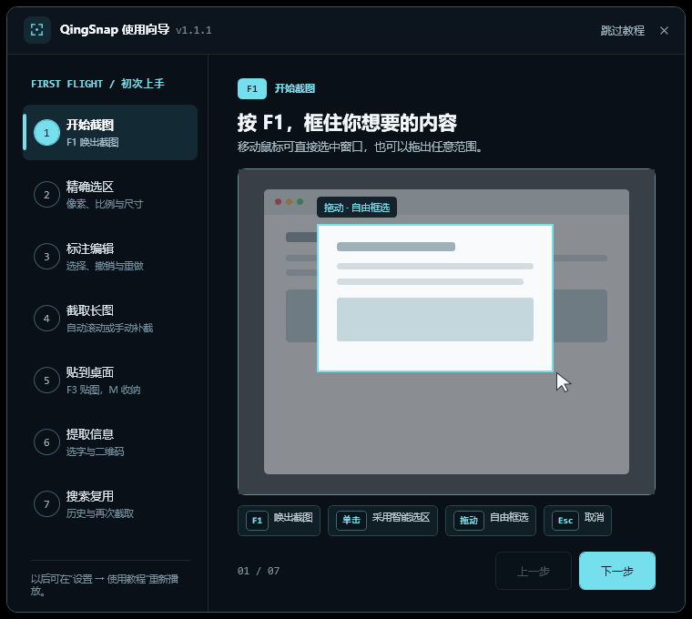

# QingSnap（轻截）

[<kbd>简体中文</kbd>](README.md)　[<kbd>English</kbd>](README_EN.md)　[<kbd>繁體中文</kbd>](README_ZH_TW.md)　[<kbd>日本語</kbd>](README_JA.md)　[<kbd>한국어</kbd>](README_KO.md)

> 截得准，拼得长，贴得住；需要文字时，再按需安装离线 OCR。

QingSnap 是一款面向 Windows 10/11 的轻量截图工具。它把智能截图、精确选区、可编辑标注、自动长截图、桌面贴图、离线识别和全量历史串成一条顺手的工作流。



[](https://github.com/za5132-web/QingSnap/releases/latest)


## 下载

- [下载 QingSnap v1.1.1](https://github.com/za5132-web/QingSnap/releases/download/v1.1.1/QingSnap-v1.1.1.zip)
- [查看 v1.1.1 发布说明](docs/RELEASE_NOTES_v1.1.1.md)
- [查看完整功能清单](docs/QINGSNAP_COMPLETE_FEATURE_LIST.md)

下载 ZIP 后解压，运行 `QingSnap.exe`。这是免安装便携包，需要系统已安装 [.NET 8 Desktop Runtime](https://dotnet.microsoft.com/download/dotnet/8.0)。

> 当前发布包使用自签名证书。Windows 可能提示未知发布者或证书链不受信任，请从本仓库 Release 页面下载并核对随包提供的 SHA-256。

## 一分钟掌握 QingSnap

首次启动会打开七步动态教程，也可以随时在“设置 → 使用教程”中重新播放。

| 工作流 | 你可以做什么 |
| --- | --- |
| 1. 开始截图 | 按 `F1` 智能选择窗口，或拖出任意范围 |
| 2. 精确选区 | 调整 X/Y/W/H、比例和固定尺寸，用 `W/A/S/D` 微调 1px |
| 3. 标注编辑 | 添加箭头、形状、文字，使用多选与 Undo/Redo 继续修改 |
| 4. 截取长图 | 自动滚动拼接；复杂页面可切换为手动补截 |
| 5. 贴到桌面 | 按 `F3` 贴出最近图片，按 `M` 收纳到屏幕边缘 |
| 6. 提取信息 | 像文档一样选取图片文字，或点击二维码识别热点 |
| 7. 搜索复用 | 按文字、标签或来源找回截图，再次贴图或回到原位置截图 |

## 核心能力

### 智能、精确的区域截图

- 鼠标悬停识别窗口和标准控件，也可自由框选。
- 支持八方向调整、X/Y/W/H 物理像素输入与像素放大镜。
- 自由、`1:1`、`4:3`、`3:2`、`16:9`、`9:16` 和当前比例锁定。
- 固定尺寸后只移动不缩放；`Shift` 保持比例，`Alt` 以中心缩放。
- `W/A/S/D` 微调准星；连续按 `R` 循环最近五个选区。
- 兼容 Per-Monitor V2、多显示器、混合 DPI 与负坐标屏幕。

### 截完仍能继续编辑

- 画笔、直线、单头/双头箭头、矩形、椭圆、文字、序号、马赛克、高亮和模糊。
- 完整 Undo/Redo：绘制、删除、移动、缩放、端点、内容、样式、图层、粘贴和清空均可恢复。
- `F2` 进入选择工具；支持 Shift 多选、框选、批量移动、复制粘贴、删除和图层调整。
- 可继续编辑文字、序号及直线/箭头方向；滚轮快速调整标注参数。

### 自动与手动长截图

- 自动滚动、稳定采样、重叠匹配、到底判断和失败重试。
- 能识别固定标题栏与底栏，避免在最终长图中重复出现。
- 动态或不规则页面可改用手动逐屏补截，并允许回退最后一屏。
- 长图贴出后进入阅读模式，支持滚轮浏览、进度、回到顶部与完整概览。

### 不打扰工作的桌面贴图

- `F3` 循环贴出最近五张截图或外部剪贴板图片。
- 截图贴回原位置；外部复制图片贴到鼠标所在位置。
- 支持拖动、平滑缩放、`1:1`、适应屏幕、复制、OCR 和二维码识别。
- 按 `M` 收纳为屏幕侧边缩略标签；悬停展开，单击回到收纳前位置。
- 将贴图用力拖到屏幕边缘松开，也会平滑收纳。

### 可选离线 OCR 与基础二维码识别

- 基础包默认不携带 OCR 运行库，截图、长图、标注、贴图、历史和二维码均可独立使用。
- 真正使用 OCR 时，可在设置中一键安装运行库并选择 PP-OCRv6 Tiny 或 Small。
- 普通贴图和长图都可以直接拖选文字，用 `Ctrl+C` 复制，无需显示分词框。
- 二维码识别完全离线且不依赖 OCR 模块；支持 QR Code，并可识别 Data Matrix、Aztec 和 PDF417。
- 识别结果直接显示在二维码原位置；悬停预览内容，链接只在用户主动点击后打开。

### 全量、可搜索的截图历史

- 图片继续以普通 PNG/JPG/BMP 文件保存，SQLite 只管理元数据和索引。
- 搜索覆盖全部历史，可匹配文件名、尺寸、OCR 文字、标签、来源程序和窗口标题。
- 每页 80 条增量加载、滚动预取、WPF 虚拟化、280px 按需缩略图与 150 张 LRU 缓存。
- 支持列表/图标模式、多选、批量收藏、标签、复制路径和删除到回收站。
- 记录截图来源与物理选区，可贴图对照，也可“再次截取此位置”。
- 数据库损坏时不会影响图片文件，可扫描历史目录重建基础索引。

## v1.1.1 更新内容

- 首次教程重构为七页“一分钟核心工作流”，不再逐项堆叠功能说明。
- 第 1～7 页全部加入独立模拟动画，覆盖截图、精确选区、标注、长图、贴图收纳、OCR/QR 和历史复用。
- 统一教程 Keycap、图标层级、圆角与动画视觉；修复贴图图钉、二维码热点和 `Ctrl+C` 提示裁切。
- 支持系统“减少动画”，关闭动画时仍显示每页可理解的关键状态。
- 加固教程窗口关闭、快速切页和首次完成状态；50 个窗口、每窗 20 次七页往返未发现线性资源增长。
- 项目主页改为简体中文、English、繁體中文、日本語、한국어五种独立语言页面，可从顶部按钮切换。

## 常用快捷键

### 全局与截图

| 操作 | 默认快捷键 |
| --- | --- |
| 区域截图 | `F1` |
| 贴图 / 循环最近图片 | `F3` |
| 最近一次截图范围 | `Shift+F1` |
| 选区内循环最近五个范围 | `R` |
| 截图准星移动 1px | `W` `A` `S` `D` |
| 复制当前 HEX 颜色 | `I` |
| 进入选择 / 编辑 | `F2` |
| 撤销 / 重做 | `Ctrl+Z` / `Ctrl+Y` |
| 确认 / 取消 | `Enter` / `Esc` |

自动长截图、手动长截图、OCR 最新截图、打开历史与暂停全局快捷键均可在设置中配置。点击快捷键输入框后直接按目标组合即可录入。

### 贴图与长图阅读

| 操作 | 快捷键 |
| --- | --- |
| 收纳 / 恢复贴图 | `M` |
| 复制图片或选中文字 | `Ctrl+C` |
| 选择全部 OCR 文字 | `Ctrl+A` |
| 回到顶部 / 底部 | `Home` / `End` |
| 长图翻页 | `PageUp` / `PageDown` / `Space` |
| 关闭贴图 | `Esc` |

## 数据与隐私

- 截图历史默认位于 `%LOCALAPPDATA%\QingSnap\History`。
- OCR 运行库和模型位于 `%LOCALAPPDATA%\QingSnap\Ocr`。
- 截图、OCR 图片、识别文字和二维码内容不会上传到第三方服务。
- 网络只用于用户主动下载 OCR 组件、检查更新或下载 Release。
- `portable.flag` 模式下配置、数据库与相关数据跟随便携目录。
- 反馈包由用户主动生成，可先检查内容；日志不包含截图、剪贴板图片或 OCR 正文。

## 系统要求

- Windows 10/11 64 位
- .NET 8 Desktop Runtime
- WPF / Per-Monitor V2 DPI

## 从源码构建

```powershell
dotnet restore QingSnap.sln
dotnet build QingSnap.sln -c Release
dotnet test tests\QingSnap.Tests\QingSnap.Tests.csproj -c Release
dotnet run --project src\QingSnap.App\QingSnap.App.csproj
```

主要技术：C#、.NET 8、WPF、Windows 原生截图/剪贴板/热键/DPI API、Microsoft.Data.Sqlite、ZXing.Net，以及可选 RapidOCR.Net / PaddleOCR。

## 文档

- [完整功能清单](docs/QINGSNAP_COMPLETE_FEATURE_LIST.md)
- [v1.1.1 发布说明](docs/RELEASE_NOTES_v1.1.1.md)
- [更新日志](CHANGELOG.md)
- [OCR 模块说明](docs/OCR_MODULE.md)
- [历史 Metadata 说明](docs/HISTORY_METADATA.md)
- [首次教程最终回归报告](docs/QINGSNAP_V1.1_FIRST_RUN_TUTORIAL_REPORT.md)
- [第三方组件声明](THIRD_PARTY_NOTICES.md)

## 反馈

欢迎通过 [GitHub Issues](https://github.com/za5132-web/QingSnap/issues) 提交问题。设置页中的“问题反馈”可以生成包含描述和可选日志的反馈包，并打开提交页面。

## 项目状态与许可

QingSnap 正在持续迭代，开发过程由 Codex 协助完成。

当前仓库未授予开源许可证，源代码仅供查看。使用、修改或再发布前，请先取得作者授权。第三方组件遵循各自许可证，详见 [THIRD_PARTY_NOTICES.md](THIRD_PARTY_NOTICES.md)。
