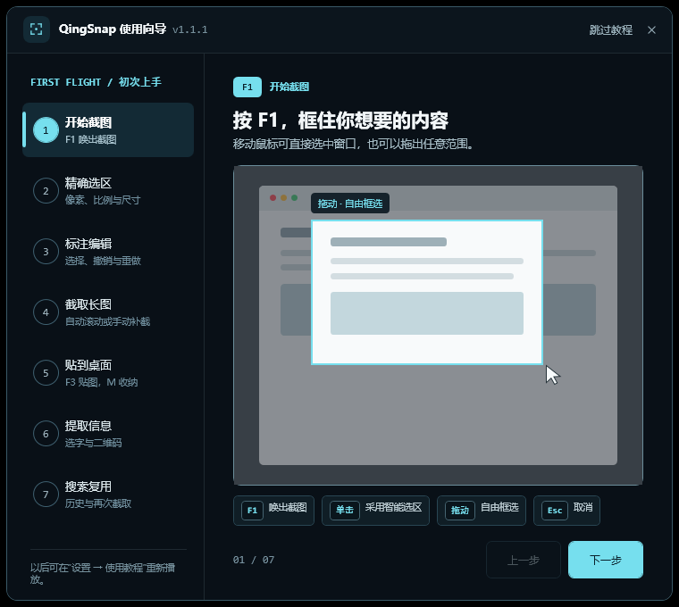
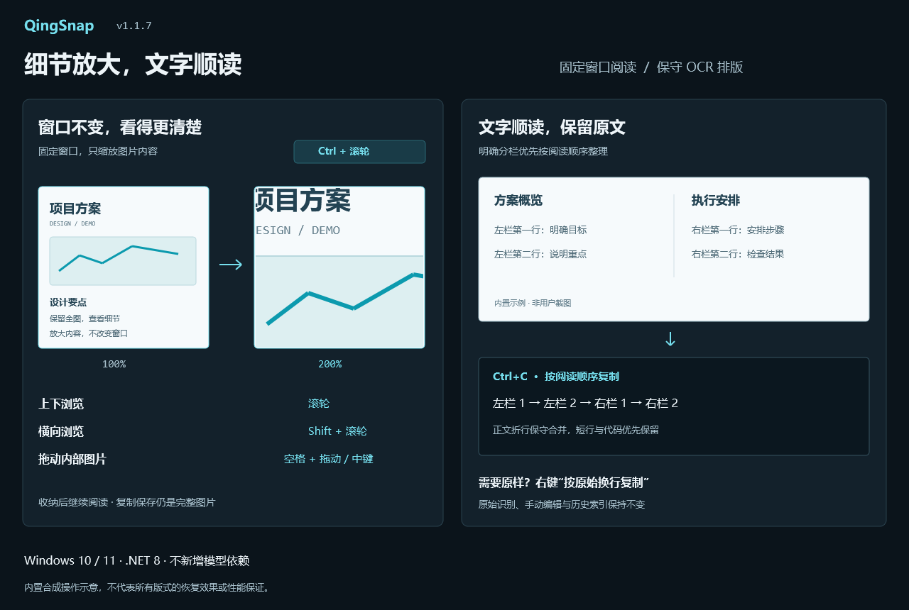
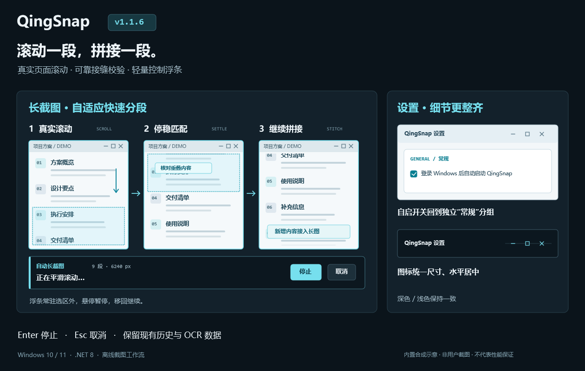
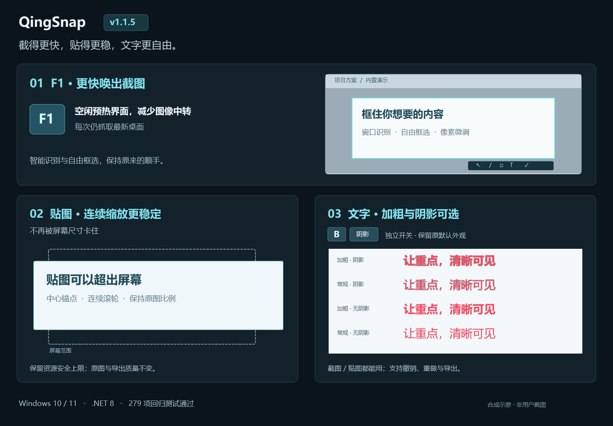
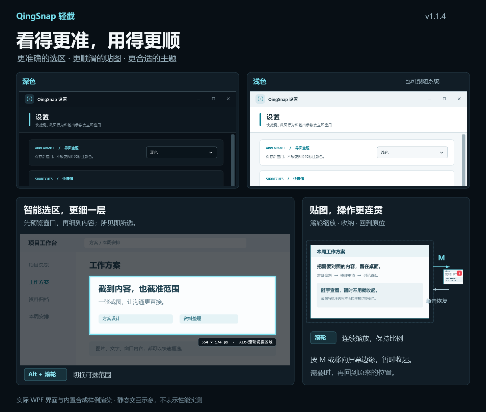
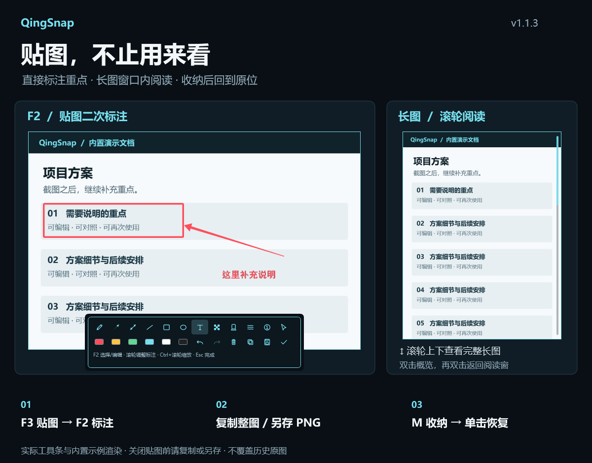

# QingSnap

[<kbd>简体中文</kbd>](README.md)　[<kbd>English</kbd>](README_EN.md)　[<kbd>繁體中文</kbd>](README_ZH_TW.md)　[<kbd>日本語</kbd>](README_JA.md)　[<kbd>한국어</kbd>](README_KO.md)

> 正確に切り取り、長くつなぎ、デスクトップに残す。OCR は必要なときだけオフラインで追加できます。

QingSnap は Windows 10/11 向けの軽量スクリーンショットツールです。スマート選択、ピクセル単位の調整、編集可能な注釈、スクロールキャプチャ、デスクトップピン、オフライン認識、履歴検索を一つのワークフローにまとめています。

> QingSnap が日々のキャプチャやピン留めに役立ったら、右上の **⭐ Star** で応援していただけるとうれしいです。必要としているお友達にもぜひ紹介してください。いつも応援ありがとうございます！



[](https://github.com/za5132-web/QingSnap/releases/latest)


## ダウンロード

- [QingSnap v1.1.7 をダウンロード](https://github.com/za5132-web/QingSnap/releases/download/v1.1.7/QingSnap-v1.1.7.zip)
- [v1.1.7 リリースノート](docs/RELEASE_NOTES_v1.1.7.md)
- [全機能一覧（中国語）](docs/QINGSNAP_COMPLETE_FEATURE_LIST.md)

ZIP を展開して `QingSnap.exe` を実行してください。[.NET 8 Desktop Runtime](https://dotnet.microsoft.com/download/dotnet/8.0) が必要です。リリースは自己署名のため、GitHub Release から取得し SHA-256 を確認してください。

## 1分で分かるワークフロー

初回起動時に7ステップのアニメーションガイドが表示され、設定からいつでも再生できます。

1. `F1` でキャプチャを開始し、ウィンドウを選ぶか自由に範囲指定。
2. X/Y/W/H、比率、固定サイズ、1px 移動で正確に調整。
3. 矢印、図形、文字を追加し、複数選択と Undo/Redo で再編集。
4. 自動スクロールまたは手動フレームで長いページをキャプチャ。
5. `F3` で画像を貼り付け、`M` で画面端に収納。
6. 文書のように画像内テキストを選択し、QR ホットスポットを操作。
7. 文字、タグ、取得元で履歴を検索し、再利用または同じ位置を再キャプチャ。

## 主な機能

- **高精度キャプチャ**：ウィンドウ認識、8方向調整、ピクセル拡大鏡、比率/固定サイズ、`W/A/S/D` 微調整、直近5範囲の呼び出し。
- **編集可能な注釈**：ペン、線、単方向/双方向矢印、図形、文字、番号、モザイク、ハイライト、ぼかし、完全な Undo/Redo と複数選択。
- **長いスクリーンショット**：自動スクロール、重なり照合、固定ヘッダー除去、再試行、手動補完、専用リーダー。
- **デスクトップピン**：直近5画像、外部クリップボード、滑らかな拡大縮小、元位置への復元、`M` 収納とホバー展開。
- **オフライン OCR / QR**：OCR は Tiny/Small を必要時にワンクリック導入。QR は OCR と独立して完全オフライン動作。
- **全履歴検索**：SQLite メタデータ、タグ、取得元、ページング、仮想化、複数選択、一括操作、再キャプチャ。
- **マルチモニター**：Per-Monitor V2、異なる DPI、負の仮想座標に対応。

## v1.1.7

- ピンに二層ズームを追加。通常のホイール操作はウィンドウを拡大縮小し、`Ctrl+ホイール` はウィンドウを固定して画像内部を拡大します。
- 閲覧中は縦横スクロール、Space+左ドラッグまたは中ボタンドラッグで移動できます。通常の閲覧ピンはダブルクリックで全体と前の詳細に切り替え、長い画像の既存操作は維持します。
- 文字選択、QR ホットスポット、注釈は画像座標に追従。収納後も閲覧位置を復元し、コピー・保存では画像全体を出力します。
- OCR の明確な段組み、本文の折り返し、文字枠で裏付けられた空白を保守的に整理。元の改行でコピーでき、手動編集と履歴索引を変更しません。
- 回帰テスト 423 件合格、Release は警告・エラーともにゼロ。複雑なレイアウトは確認が必要で、翻訳や新しいモデル依存は追加していません。



## v1.1.6

- 長いページを実際に分割スクロールし、停止を確認して原画質で照合・結合してから続行します。実際の移動量に合わせてスクロール幅を自動調整します。
- 操作バーは選択範囲の外に常時表示され、フォーカスを奪ったり毎回点滅したりしません。ホバーで一時停止し、範囲に戻ると再開。`Enter` で停止して手動補完、`Esc` でキャンセルできます。
- 失敗時は最後に成功した画面への復帰を確認し、対象やフォーカスの変更・入力位置の遮蔽で停止します。細かいホイール入力に反応しない旧式コントロールには、間隔を空けた通常刻みの入力を試します。
- Windows 起動時の自動実行を独立した「一般」グループへ移動。最小化・最大化／元に戻す・閉じるアイコンのサイズと位置を統一しました。
- 既存の設定、OCR、履歴データは維持されます。滑らかさは対象アプリに依存します。複雑なページでは継ぎ目を確認し、必要に応じて手動で補完してください。



## v1.1.5

- アイドル時の UI 事前読み込みと画像変換の削減により F1 の応答を改善。毎回最新のデスクトップを取得します。
- ピン拡大縮小時の揺れ、古いフレームの残像、黒い帯を修正。リソース上限を保ちながら画面外まで拡大できます。
- スクリーンショットとピンの文字注釈に、個別の太字・影オプションを追加。元に戻す・やり直し・スタイルのコピーに対応します。
- 回帰テスト 279 件合格、Release ビルド 0 Warning / 0 Error。異なる GPU、混在 DPI、高リフレッシュレートでの実機確認は引き続き推奨します。



## v1.1.4

- 即時のウィンドウ認識とバックグラウンドでのパネル認識を自動で組み合わせ、モード切替を不要にしました。プレビュー中は `Alt+ホイール` で候補の階層を切り替えられます。
- ピンの拡大縮小と画面端への収納を、連続入力に追従する短いアニメーションに変更。一部の DPI 設定で最初の拡大縮小が急に大きくなる問題を修正しました。
- ダーク・ライト・システム連動テーマを追加。設定を保存すると適用され、原画像・注釈の色・書き出す画像は変わりません。
- 自動テスト 235 件合格、Release ビルド 0 Warning / 0 Error。認識結果は対象アプリに依存します。実機での混在 DPI・高リフレッシュレートは、引き続き手動検証が必要です。



## v1.1.3

- F2 または右クリックでピン画像に注釈を追加。文字、矢印、複数選択、Undo/Redo、画像全体のコピーと PNG 保存に対応。
- 長い画像を元の選択範囲サイズで表示。ホイールで閲覧し、ダブルクリックで全体表示と閲覧位置を切り替え。
- 画面端への収納から復元できなくなる問題を修正し、編集前の OCR/QR 結果を無効化。
- 注釈は現在のピンウィンドウ内に保持されます。閉じる前にコピーまたは保存してください。履歴の原画像は変更しません。



## v1.1.2

- 履歴から呼び出した範囲を移動・サイズ変更してマウスを離すと、選択範囲が消える問題を修正しました。
- PR #1 を提供してくださった [@zch-soft](https://github.com/zch-soft) に感謝します。既存機能とデータ互換性を維持します。

## v1.1.1

- 初回ガイドを7ページの「1分コアワークフロー」に再構成。
- 全ページにユーザーデータを読み取らない内蔵シミュレーションアニメーションを追加。
- Keycap、アイコン階層、角丸、ヒントを統一し、ピン、QR、`Ctrl+C` のクリッピングを修正。
- Windows の「アニメーションを表示しない」設定に対応し、ページ切替と終了時の解放処理を強化。
- 自動テスト 149/149、Release ビルド 0 Warning / 0 Error。

## ショートカット

| 操作 | キー |
| --- | --- |
| 範囲キャプチャ | `F1` |
| ピン / 最近画像を循環 | `F3` |
| 前回範囲 | `Shift+F1` |
| 直近5範囲を循環 | `R` |
| 選択 / 編集 | `F2` |
| 元に戻す / やり直す | `Ctrl+Z` / `Ctrl+Y` |
| ピンを収納 / 復元 | `M` |
| 確定 / キャンセル | `Enter` / `Esc` |

## プライバシーとビルド

画像、OCR テキスト、QR 内容は第三者へ送信されません。通信はユーザーが開始した OCR ダウンロード、更新確認、Release ダウンロードにのみ使用します。

```powershell
dotnet restore QingSnap.sln
dotnet build QingSnap.sln -c Release
dotnet test tests\QingSnap.Tests\QingSnap.Tests.csproj -c Release --filter "FullyQualifiedName!~HistoryDirectoryMigrationTests"
```

上記のコマンドでは、実際の Windows スタートアップ項目を変更する旧移行テスト 1 件を除外します。この項目が検証済みという意味ではありません。

問題は [GitHub Issues](https://github.com/za5132-web/QingSnap/issues) へお寄せください。現在オープンソースライセンスは付与されていません。利用、変更、再配布には作者の許可が必要です。

