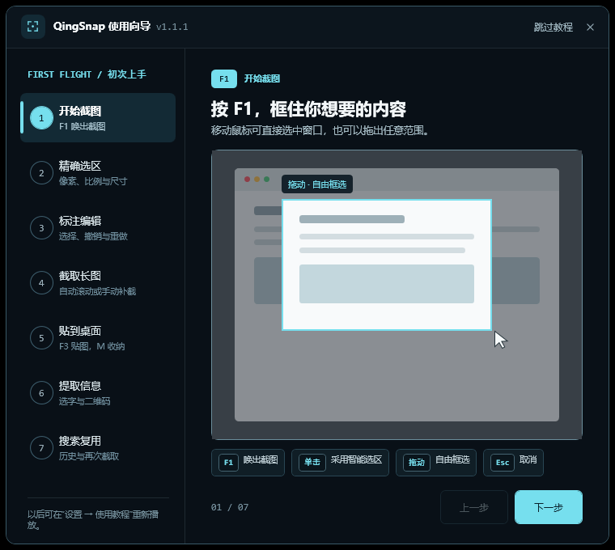
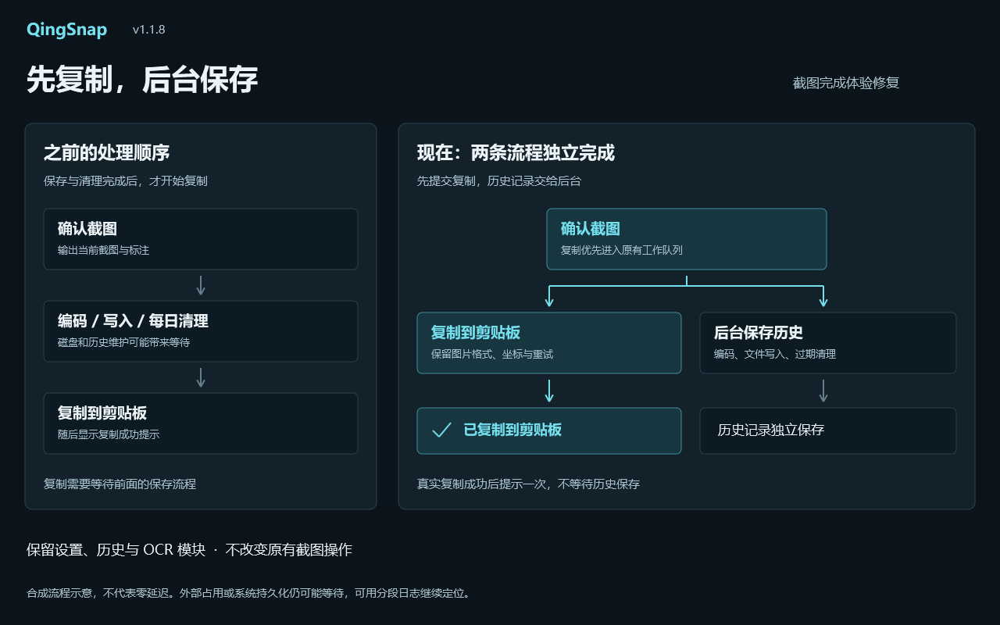
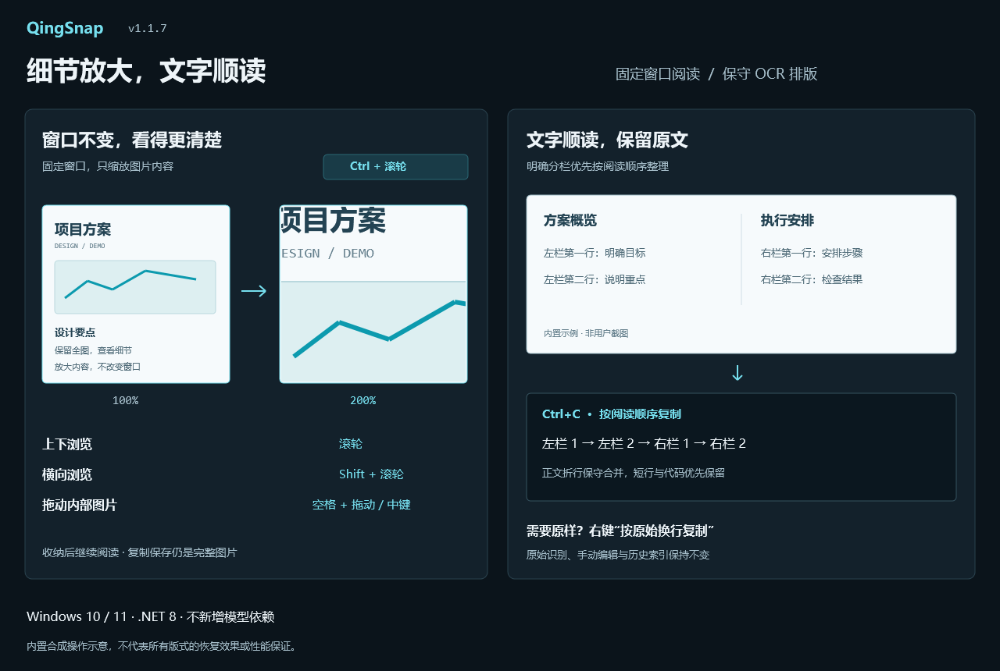
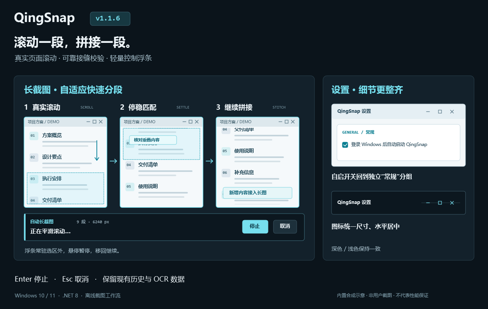
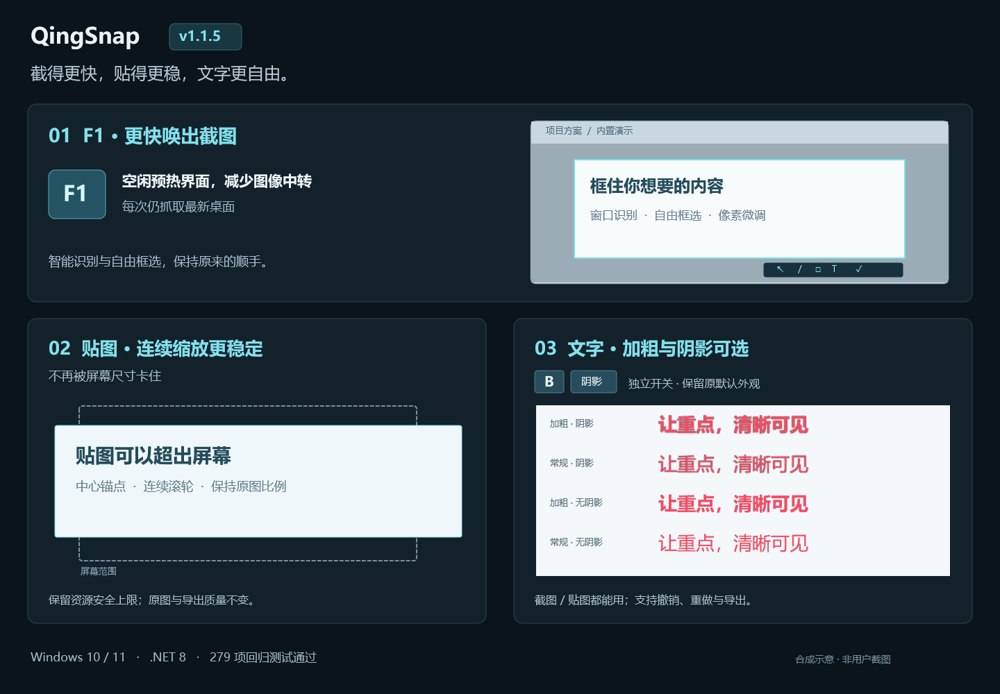
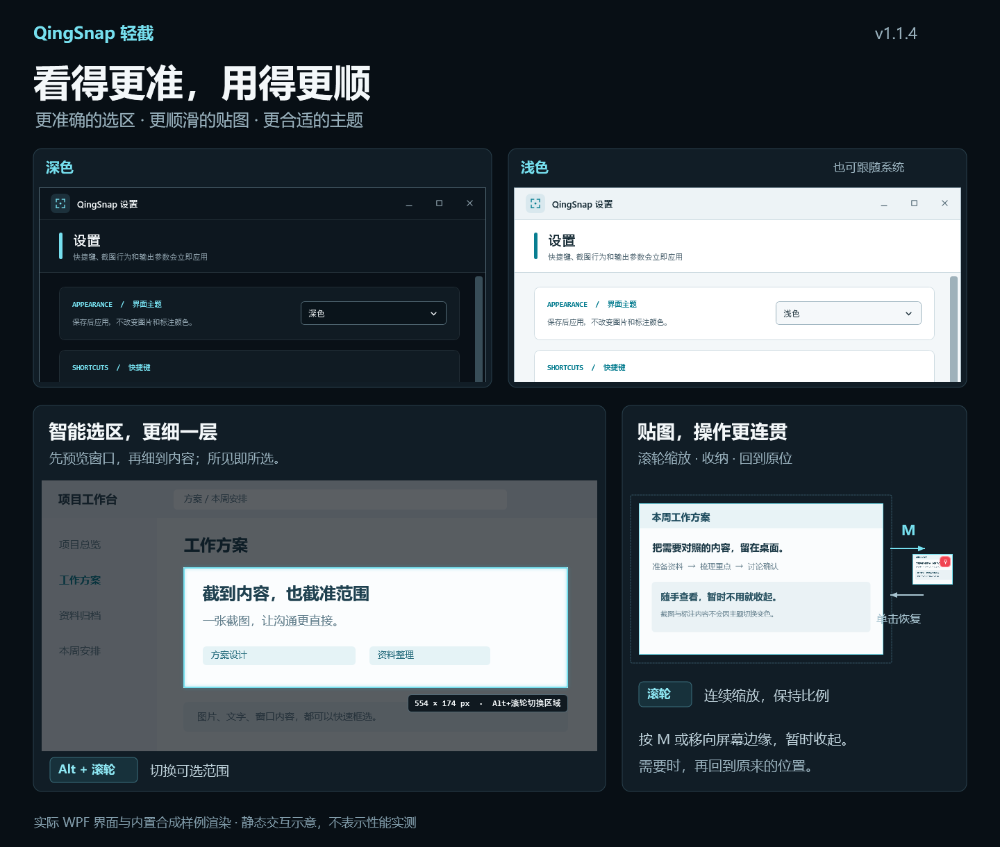
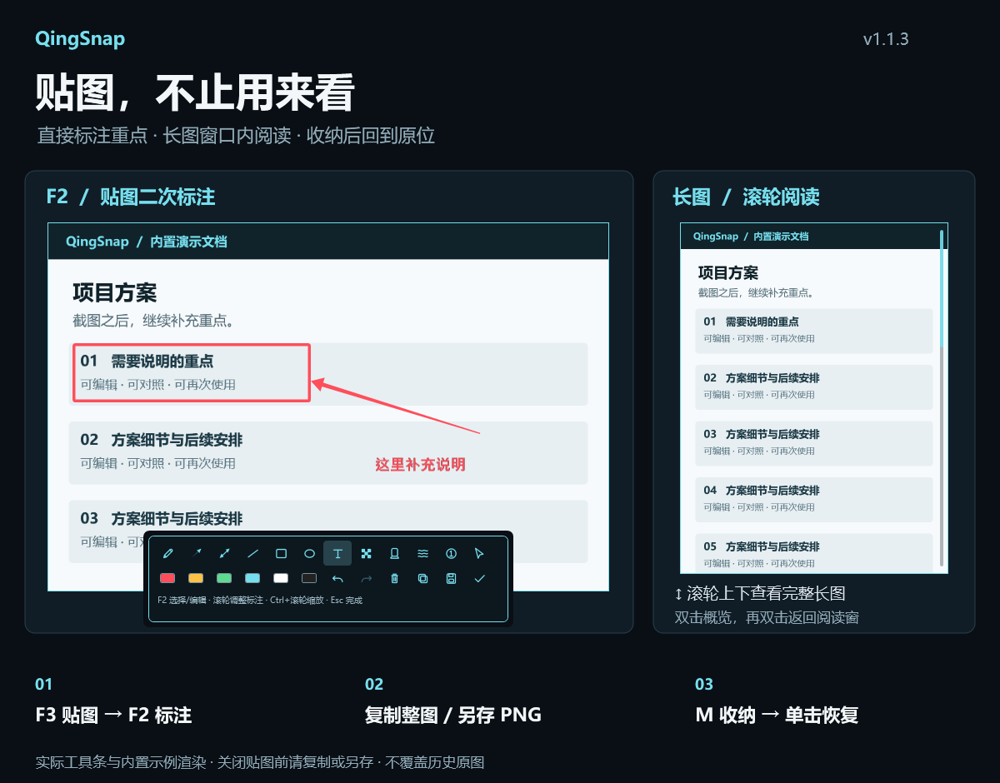

# QingSnap

[<kbd>简体中文</kbd>](README.md)　[<kbd>English</kbd>](README_EN.md)　[<kbd>繁體中文</kbd>](README_ZH_TW.md)　[<kbd>日本語</kbd>](README_JA.md)　[<kbd>한국어</kbd>](README_KO.md)

> 정확하게 캡처하고, 길게 이어 붙이고, 바탕 화면에 고정합니다. OCR은 필요할 때만 오프라인으로 설치하세요.

QingSnap은 Windows 10/11용 경량 스크린샷 도구입니다. 스마트 선택, 픽셀 단위 조정, 편집 가능한 주석, 스크롤 캡처, 바탕 화면 핀, 오프라인 인식, 전체 기록 검색을 하나의 흐름으로 제공합니다.

> QingSnap 덕분에 캡처와 핀 작업이 조금 더 편해졌다면, 오른쪽 위의 **⭐ Star**로 응원해 주세요. 이 작은 도구를 계속 다듬는 데 힘이 됩니다. 필요한 친구에게도 소개해 주시면 감사하겠습니다!



[](https://github.com/za5132-web/QingSnap/releases/latest)


## 다운로드

- [QingSnap v1.1.8 다운로드](https://github.com/za5132-web/QingSnap/releases/download/v1.1.8/QingSnap-v1.1.8.zip)
- [v1.1.8 릴리스 노트](docs/RELEASE_NOTES_v1.1.8.md)
- [전체 기능 목록(중국어)](docs/QINGSNAP_COMPLETE_FEATURE_LIST.md)

ZIP 압축을 풀고 `QingSnap.exe`를 실행하세요. [.NET 8 Desktop Runtime](https://dotnet.microsoft.com/download/dotnet/8.0)이 필요합니다. 릴리스는 자체 서명이므로 GitHub Release에서만 내려받고 SHA-256을 확인하세요.

## 1분 핵심 흐름

첫 실행 시 7단계 애니메이션 가이드가 열리며 설정에서 언제든 다시 볼 수 있습니다.

1. `F1`로 캡처를 시작하고 창을 선택하거나 자유롭게 영역을 지정합니다.
2. X/Y/W/H, 비율, 고정 크기, 1px 이동으로 영역을 정밀 조정합니다.
3. 화살표, 도형, 텍스트를 추가하고 다중 선택과 Undo/Redo로 다시 편집합니다.
4. 자동 스크롤 또는 수동 프레임으로 긴 페이지를 캡처합니다.
5. `F3`로 최근 이미지를 붙이고 `M`으로 화면 가장자리에 보관합니다.
6. 문서처럼 이미지 텍스트를 선택하거나 QR 핫스폿을 사용합니다.
7. 텍스트, 태그, 출처로 기록을 검색하고 다시 붙이거나 같은 위치를 캡처합니다.

## 주요 기능

- **정밀 캡처**: 창 인식, 8방향 조정, 픽셀 확대경, 비율/고정 크기, `W/A/S/D` 미세 이동, 최근 5개 영역 순환.
- **편집 가능한 주석**: 펜, 선, 단/양방향 화살표, 도형, 텍스트, 번호, 모자이크, 강조, 흐림, 전체 Undo/Redo와 다중 선택.
- **긴 스크린샷**: 자동 스크롤, 겹침 매칭, 고정 헤더 제거, 재시도, 수동 보충, 전용 긴 이미지 리더.
- **바탕 화면 핀**: 최근 5개 이미지와 외부 클립보드, 부드러운 확대/축소, 원래 위치 복원, `M` 보관과 호버 펼침.
- **오프라인 OCR / QR**: OCR Tiny/Small은 필요할 때 한 번에 설치하고, QR은 OCR 없이 완전 오프라인으로 동작합니다.
- **전체 기록 검색**: SQLite 메타데이터, 태그, 출처, 페이지 로딩, 가상화, 다중 선택, 일괄 작업과 재캡처.
- **다중 모니터**: Per-Monitor V2, 혼합 DPI, 음수 가상 화면 좌표 지원.

## v1.1.8 업데이트

- 캡처 후 이미지 인코딩·디스크 저장·일일 기록 정리가 끝나야 복사를 시작하던 처리 순서를 수정했습니다.
- 클립보드 복사를 먼저 요청하고 기록은 백그라운드에서 독립적으로 저장합니다. 실제 복사 성공 후 한 번만 알리고 기록 저장 완료를 기다리지 않습니다.
- 재시도, 이미지 형식, 캡처 영역 정보를 유지합니다. 같은 밀리초의 파일명 충돌을 방지하고 종료 시 대기 중인 파일 저장을 기다립니다.
- 단계별 소요 시간 로그를 추가했습니다. 다른 프로그램이 클립보드를 계속 점유하면 지연될 수 있으며 지연이 전혀 없다고 보장하지 않습니다.
- 회귀 테스트 436개 통과, Release 경고·오류 없음. 기존 설정, OCR 모듈, 기록 데이터와 호환됩니다.



## v1.1.7 업데이트

- 핀에 이중 확대/축소를 추가했습니다. 일반 휠은 창 크기를 바꾸고, `Ctrl+휠`은 창을 고정한 채 내부 이미지만 확대합니다.
- 읽기 모드에서 세로/가로 스크롤과 Space+왼쪽 드래그 또는 가운데 버튼 드래그를 지원합니다. 일반 읽기 핀은 더블 클릭으로 전체와 이전 세부 보기를 전환하고 긴 이미지의 기존 동작은 유지합니다.
- 텍스트 선택, QR 영역, 주석은 이미지 좌표를 따릅니다. 보관 후 읽던 위치를 복원하며 복사/저장은 전체 이미지를 출력합니다.
- 명확한 다단 배치, 본문 줄바꿈 및 글자 좌표로 확인되는 공백을 보수적으로 정리합니다. 원래 줄바꿈 복사를 제공하고 수동 편집과 기록 색인은 변경하지 않습니다.
- 회귀 테스트 423개 통과, Release 경고/오류 없음. 복잡한 레이아웃은 확인이 필요하며 번역이나 새 모델 의존성은 추가하지 않았습니다.



## v1.1.6 업데이트

- 실제 페이지를 구간별로 스크롤하고, 화면이 멈추면 원본 해상도로 맞춰 붙인 뒤 계속합니다. 실제 콘텐츠 이동량에 따라 스크롤 폭을 자동 조정합니다.
- 제어 막대는 캡처 영역 밖에 유지되며 포커스를 빼앗거나 구간마다 깜박이지 않습니다. 마우스를 올리면 일시 정지하고 영역으로 돌아가면 재개합니다. `Enter`로 멈춘 뒤 수동으로 보충하거나 `Esc`로 취소할 수 있습니다.
- 실패 시 마지막으로 성공한 화면까지 돌아왔는지 확인합니다. 대상·포커스가 바뀌거나 입력 위치가 가려지면 중지하며, 세밀한 휠 입력에 반응하지 않는 구형 컨트롤에는 간격을 둔 일반 눈금 입력을 시도합니다.
- Windows 자동 시작 옵션을 독립된 “일반” 그룹으로 옮기고 최소화·최대화/복원·닫기 아이콘의 크기와 정렬을 통일했습니다.
- 기존 설정, OCR 및 기록 데이터는 유지됩니다. 스크롤의 부드러움은 대상 앱에 따라 다르므로 복잡한 페이지는 연결 부분을 확인하고 필요하면 수동으로 보충하세요.



## v1.1.5 업데이트

- 유휴 시간 UI 준비와 이미지 변환 감소로 F1 응답을 개선했습니다. 매번 최신 바탕 화면을 캡처합니다.
- 핀 확대/축소의 떨림, 이전 프레임 잔상과 검은 띠를 수정했습니다. 리소스 한도를 유지하면서 화면 밖까지 확대할 수 있습니다.
- 캡처 및 핀의 텍스트 주석에 굵게/그림자 옵션을 각각 추가했습니다. 실행 취소, 다시 실행 및 스타일 복사를 지원합니다.
- 회귀 테스트 279개 통과, Release 빌드 0 Warning / 0 Error. GPU, 혼합 DPI, 높은 주사율은 실제 환경에서 추가 확인을 권장합니다.



## v1.1.4 업데이트

- 즉각적인 창 인식과 백그라운드 패널 인식을 자동으로 결합해 모드 전환이 필요하지 않습니다. 미리보기 중 `Alt+휠`로 후보 계층을 전환할 수 있습니다.
- 핀 확대/축소와 가장자리 보관을 연속 입력에 대응하는 짧은 애니메이션으로 개선했습니다. 일부 DPI 환경에서 첫 확대/축소가 갑자기 커지는 문제를 수정했습니다.
- 어두운 테마, 밝은 테마, 시스템 설정 따르기를 추가했습니다. 설정을 저장하면 적용되며 원본, 주석 색상, 내보낸 이미지는 변하지 않습니다.
- 자동화 테스트 235개 통과, Release 빌드 0 Warning / 0 Error. 인식 결과는 대상 앱에 따라 달라지며 실제 혼합 DPI 및 높은 주사율 환경은 추가 수동 검증이 필요합니다.



## v1.1.3 업데이트

- F2 또는 우클릭으로 핀 이미지에 주석을 추가합니다. 텍스트, 화살표, 다중 선택, 실행 취소/다시 실행, 전체 이미지 복사 및 PNG 저장을 지원합니다.
- 긴 이미지를 원래 캡처 영역 크기로 표시하고 휠로 읽습니다. 더블클릭으로 전체 보기와 읽던 위치를 전환합니다.
- 화면 가장자리 수납 후 복원 중단 문제를 수정하고 편집 전 OCR/QR 결과를 무효화했습니다.
- 주석은 현재 핀 창에 유지됩니다. 닫기 전에 복사하거나 저장하세요. 기록의 원본은 변경하지 않습니다.



## v1.1.2 업데이트

- 이전 캡처 영역을 불러온 뒤 이동하거나 크기를 조절하고 마우스를 놓으면 선택 영역이 사라지는 문제를 수정했습니다.
- PR #1을 제공한 [@zch-soft](https://github.com/zch-soft)에게 감사드립니다. 기존 기능과 데이터 호환성을 유지합니다.

## v1.1.1 업데이트

- 첫 실행 가이드를 7페이지 “1분 핵심 작업 흐름”으로 재구성했습니다.
- 사용자 데이터에 접근하지 않는 내장 시뮬레이션 애니메이션을 모든 페이지에 추가했습니다.
- Keycap, 아이콘 레이어, 모서리와 안내를 통일하고 핀, QR, `Ctrl+C` 잘림을 수정했습니다.
- Windows 애니메이션 줄이기 설정을 지원하고 빠른 페이지 전환 및 종료 후 리소스 정리를 강화했습니다.
- 자동화 테스트 149/149 통과, Release 빌드 0 Warning / 0 Error.

## 단축키

| 작업 | 키 |
| --- | --- |
| 영역 캡처 | `F1` |
| 핀 / 최근 이미지 순환 | `F3` |
| 최근 영역 | `Shift+F1` |
| 최근 5개 영역 순환 | `R` |
| 선택 / 편집 | `F2` |
| 실행 취소 / 다시 실행 | `Ctrl+Z` / `Ctrl+Y` |
| 핀 보관 / 복원 | `M` |
| 확인 / 취소 | `Enter` / `Esc` |

## 개인정보 및 빌드

이미지, OCR 텍스트, QR 내용은 제3자에게 업로드되지 않습니다. 네트워크는 사용자가 시작한 OCR 다운로드, 업데이트 확인, Release 다운로드에만 사용됩니다.

```powershell
dotnet restore QingSnap.sln
dotnet build QingSnap.sln -c Release
dotnet test tests\QingSnap.Tests\QingSnap.Tests.csproj -c Release --filter "FullyQualifiedName!~HistoryDirectoryMigrationTests"
```

위 명령은 실제 Windows 시작 프로그램 항목을 변경하는 기존 마이그레이션 테스트 1개를 제외합니다. 제외된 항목은 검증을 통과한 것이 아닙니다.

문제는 [GitHub Issues](https://github.com/za5132-web/QingSnap/issues)에 남겨 주세요. 현재 오픈 소스 라이선스는 부여되지 않았으며, 사용·수정·재배포에는 작성자의 허가가 필요합니다.

