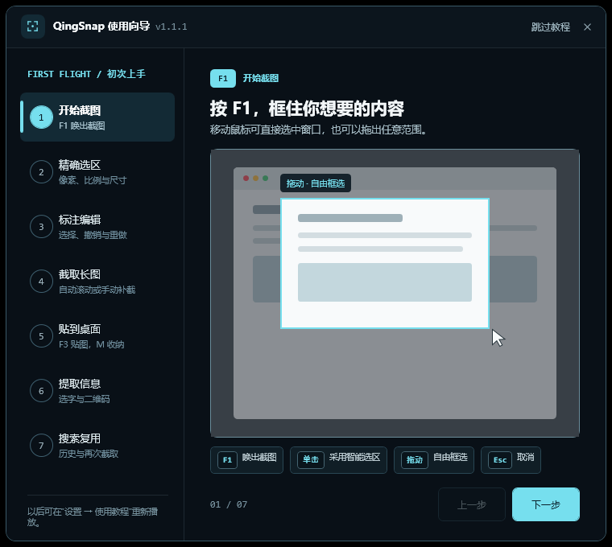
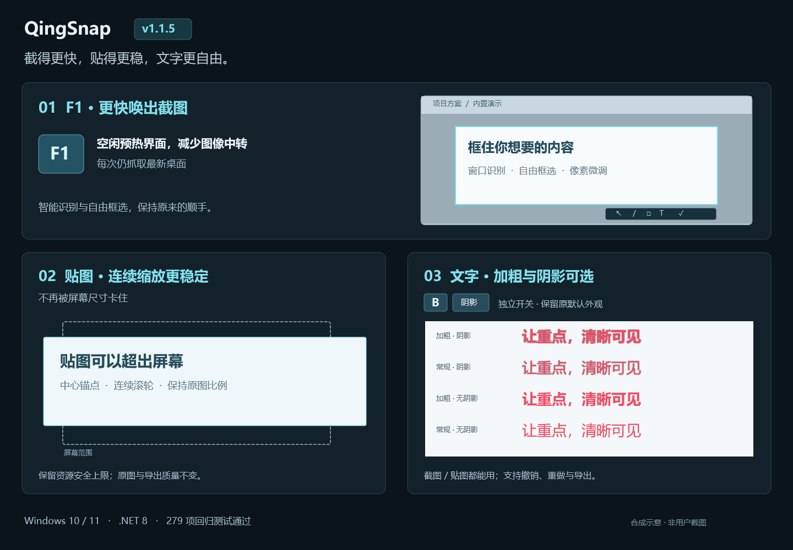
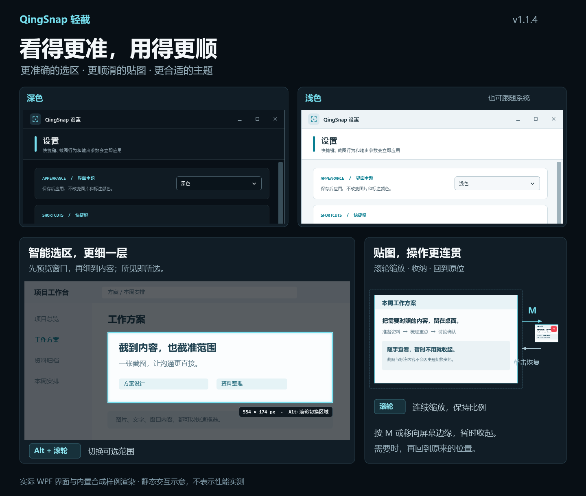
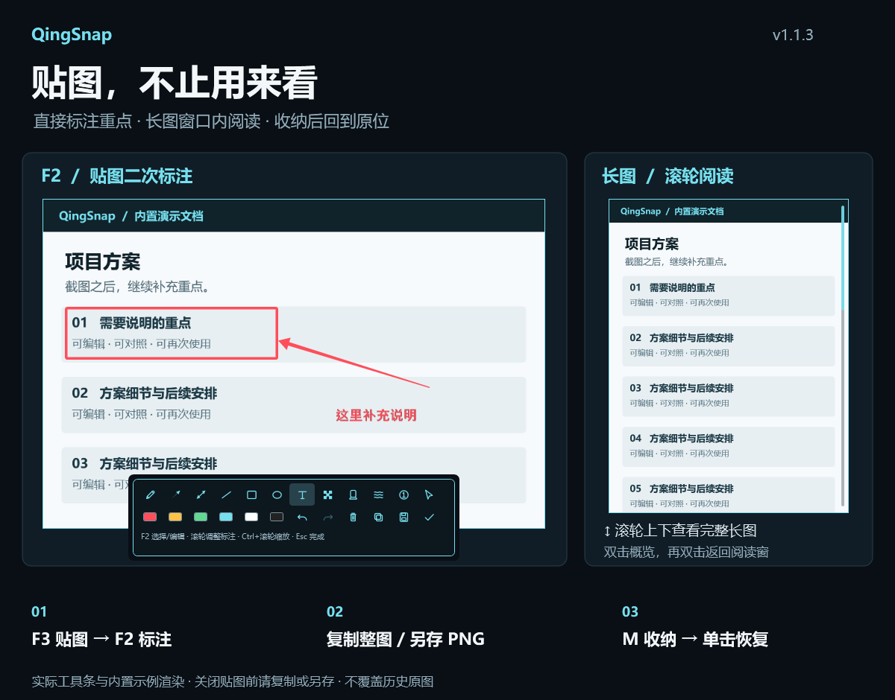

# QingSnap（輕截）

[<kbd>简体中文</kbd>](README.md)　[<kbd>English</kbd>](README_EN.md)　[<kbd>繁體中文</kbd>](README_ZH_TW.md)　[<kbd>日本語</kbd>](README_JA.md)　[<kbd>한국어</kbd>](README_KO.md)

> 截得準，拼得長，貼得住；需要文字時，再按需安裝離線 OCR。

QingSnap 是一款適用於 Windows 10/11 的輕量截圖工具，將智慧截圖、精確選區、可編輯標註、自動長截圖、桌面貼圖、離線辨識與完整歷史搜尋串成一套流暢工作流程。



[](https://github.com/za5132-web/QingSnap/releases/latest)


## 下載

- [下載 QingSnap v1.1.5](https://github.com/za5132-web/QingSnap/releases/download/v1.1.5/QingSnap-v1.1.5.zip)
- [v1.1.5 發布說明](docs/RELEASE_NOTES_v1.1.5.md)
- [完整功能清單（簡體中文）](docs/QINGSNAP_COMPLETE_FEATURE_LIST.md)

解壓 ZIP 後執行 `QingSnap.exe`。便攜包需要 [.NET 8 Desktop Runtime](https://dotnet.microsoft.com/download/dotnet/8.0)。目前使用自簽名憑證，請只從本倉庫 Release 下載並核對 SHA-256。

## 一分鐘掌握 QingSnap

首次啟動會顯示七步動態教學，也可在設定中重新播放：

1. `F1` 開始截圖：智慧選取視窗或自由框選。
2. 精確選區：調整 X/Y/W/H、比例、固定尺寸與 1px 微調。
3. 標註編輯：加入箭頭、形狀、文字、多選與 Undo/Redo。
4. 截取長圖：自動滾動拼接或手動逐屏補截。
5. 貼到桌面：`F3` 貼出圖片，`M` 收納至螢幕邊緣。
6. 提取資訊：像文件一樣選取文字，或點擊 QR 熱點。
7. 搜尋複用：依文字、標籤、來源找回圖片並再次截取。

## 主要功能

- **精確截圖**：智慧視窗辨識、八方向調整、像素放大鏡、比例/尺寸鎖定、`W/A/S/D` 微調及最近五個選區。
- **可編輯標註**：畫筆、線條、箭頭、形狀、文字、序號、馬賽克、高亮、模糊、完整 Undo/Redo 與多選批次操作。
- **長截圖**：自動滾動、重疊匹配、固定列去重、失敗重試及手動補截；長圖提供專用閱讀模式。
- **桌面貼圖**：最近五張圖片循環、外部剪貼簿、平滑縮放、原位貼回、`M` 邊緣收納與懸停展開。
- **離線 OCR / QR**：OCR 按需一鍵安裝 Tiny 或 Small；QR 基礎功能完全離線且不依賴 OCR。
- **完整歷史**：SQLite 元資料、全量搜尋、標籤、來源資訊、分頁、虛擬化、多選、批次操作與再次截取。
- **多螢幕**：支援 Per-Monitor V2、混合 DPI 與負座標顯示器。

## v1.1.5 更新

- 透過閒置時預熱介面及減少影像轉換改善 F1 回應；每次仍擷取最新桌面，而非快取畫面。
- 修正貼圖縮放抖動、舊畫面殘留與黑條；可放大超出螢幕範圍，仍保留資源安全限制。
- 截圖與貼圖文字標註可獨立切換粗體及陰影，支援復原、重做與樣式複製。
- 279 項自動化回歸通過，Release 0 Warning / 0 Error；不同顯示卡、多螢幕及高更新率仍建議實際驗證。



## v1.1.4 更新

- 智慧選區自動結合即時視窗辨識與背景面板細化，無需切換模式；預選時可用 `Alt+滾輪` 切換候選層級。
- 貼圖縮放與邊緣收納採用短暫、可連續銜接的動畫；修正部分 DPI 環境首次縮放突然跳大的問題。
- 新增深色、淺色與跟隨系統主題，於設定儲存後套用；原圖、標註顏色與匯出內容不變。
- 235 項自動化測試通過，Release 0 Warning / 0 Error；辨識仍取決於目標應用程式，真實混合 DPI 與高更新率體驗仍需人工驗證。



## v1.1.3 更新

- 貼圖按 F2 或右鍵進入二次標註，支援文字、箭頭、多選、復原/重做及完整圖片複製、另存 PNG。
- 長圖依原截圖選區大小開啟，滾輪閱讀，雙擊總覽後可返回閱讀位置。
- 修復邊緣收納恢復中斷，並在編輯後清除舊 OCR / 二維碼結果。
- 新增標註僅保留於目前貼圖視窗，關閉前請複製或另存，不覆蓋歷史原圖。



## v1.1.2 更新

- 修復叫出歷史截圖範圍後，移動或縮放並放開滑鼠可能導致選區消失的問題。
- 感謝 [@zch-soft](https://github.com/zch-soft) 提供 PR #1，保留既有功能與資料相容性。

## v1.1.1 更新

- 首次教學重構為七頁「一分鐘核心工作流程」。
- 七頁全部加入內建模擬動畫，不會讀取使用者截圖、剪貼簿或歷史。
- 統一 Keycap、圖示層級、圓角與提示，修復圖釘、QR 熱點和 `Ctrl+C` 裁切。
- 支援 Windows「減少動畫」，並加固快速切頁與視窗關閉後的資源釋放。
- 149/149 自動化測試通過；Release 0 Warning / 0 Error。

## 常用快捷鍵

| 操作 | 快捷鍵 |
| --- | --- |
| 區域截圖 | `F1` |
| 貼圖 / 循環最近圖片 | `F3` |
| 最近一次範圍 | `Shift+F1` |
| 循環最近五個選區 | `R` |
| 選區 / 編輯工具 | `F2` |
| 撤銷 / 重做 | `Ctrl+Z` / `Ctrl+Y` |
| 收納 / 恢復貼圖 | `M` |
| 確認 / 取消 | `Enter` / `Esc` |

## 隱私與建置

圖片、OCR 文字和 QR 內容不會上傳第三方。網路只用於使用者主動下載 OCR、檢查更新或下載 Release。`portable.flag` 會讓設定與資料跟隨便攜目錄。

```powershell
dotnet restore QingSnap.sln
dotnet build QingSnap.sln -c Release
dotnet test tests\QingSnap.Tests\QingSnap.Tests.csproj -c Release --filter "FullyQualifiedName!~HistoryDirectoryMigrationTests"
```

上述命令排除 1 項會修改真實 Windows 啟動項目的舊遷移測試，該項目不代表已驗證。

問題請提交至 [GitHub Issues](https://github.com/za5132-web/QingSnap/issues)。目前未授予開源授權，使用、修改或再發布前請先取得作者同意；第三方元件依各自授權使用。

