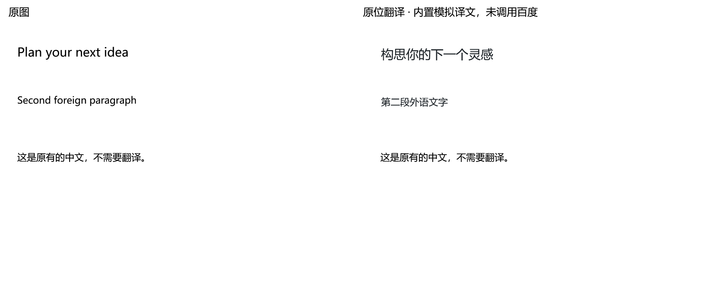
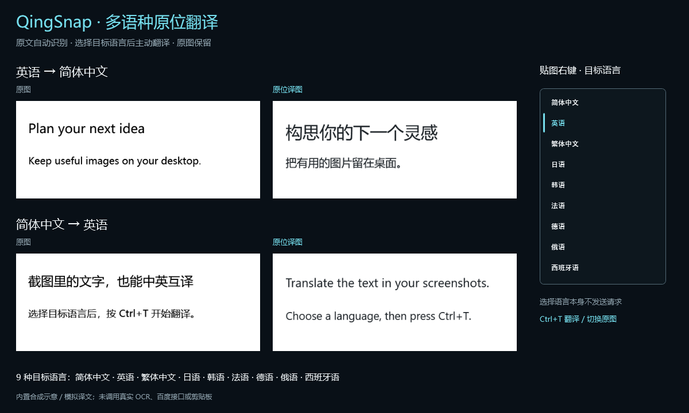
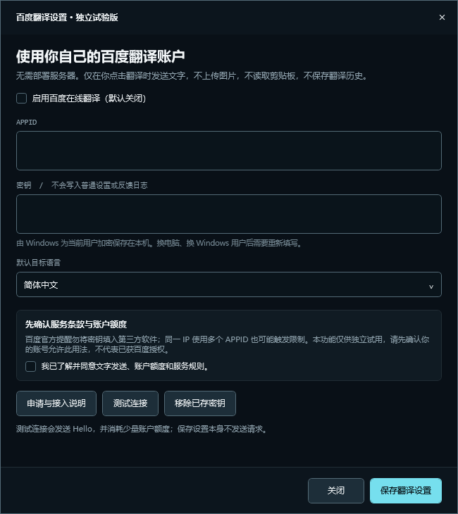

# QingSnap 百度翻译独立试验版

本分支：`experiment/baidu-translation`。产品版本保持 **v1.1.8**，不作为正式更新发布，不覆盖现用轻截。

## 试用

1. 在试验版设置的“百度翻译（试验版）”中点击“配置百度翻译”。主体验是贴图内原位翻译，独立文字对照窗口仅作辅助。
2. 在[百度翻译开放平台](https://fanyi-api.baidu.com/product/113)申请**通用文本翻译**服务，填写自己的 APPID 和密钥。不要把密钥发到聊天、Issue 或反馈中。
3. 阅读服务规则提示，确认文字云端处理与账户费用，勾选“启用百度在线翻译”。
4. 可主动点击“测试连接”：仅向百度发送 `Hello`；保存本身不发送任何翻译请求。
5. 从**试验版托盘**截图/贴图，右键“目标语言”选择所需语言，再点“翻译为…”或让贴图获得焦点后按 **Ctrl+T**。译文直接覆盖原文字区域，不打开独立翻译窗口。原文由百度自动识别。
6. 再按 Ctrl+T 或右键“查看原图 / 显示译图”，切换原图和译图，复用当前贴图缓存、不重新请求。请求期间 Ctrl+T 可取消。

其他入口：

- 贴图 / 长图：选中原图文字后，右键“原位翻译所选文字”，仅发送并覆盖这些文字区域。
- 翻译后可在译文上直接拖选文字并 Ctrl+C；英文等译文保留单词间空格。右键也能“复制完整译文”，包括因区域过小未完整显示的译文。
- 右键“复制译图 / 保存译图”明确输出当前语言版本；原“复制图片 / 另存图片”逻辑仍输出原图（包括现有标注），译图显示时菜单会明确标成“复制原图 / 保存原图”。历史图片不会被改写。
- OCR 结果窗口：“翻译”保留为辅助文字对照；试验版托盘的“文字翻译对照（辅助）”也可手动输入。

贴图未配置时只在贴图内提示，不自动打开翻译窗口。右键“翻译设置”可主动配置；OCR 未安装时提示前往试验版设置安装，不自动下载。

试验版不会继承正式版 OCR 安装及历史，避免卸载、整理、索引等操作影响现有数据。手动输入翻译不依赖 OCR；要在试验版截图选字，可在试验版设置中单独安装 OCR。试验版托盘仍可截图与贴图。

## 与正式版隔离

| 项目 | 独立试验版 |
| --- | --- |
| 版本 | 仍为 v1.1.8，标题和托盘标明试验版 |
| 设置、截图历史、SQLite、OCR、选区记录 | `%LocalAppData%\QingSnap\TranslationTrial\Data` |
| 日志 | `%LocalAppData%\QingSnap\TranslationTrial\Logs` |
| 密钥 | 独立 Data 下 `baidu-translation.credentials`，Windows DPAPI CurrentUser 加密 |
| portable.flag | 当前试验版程序所在目录的 `Data`，不改其他目录 |
| 全局 F1 / F3 等 | 默认不注册；正式版退出后，可显式使用允许全局快捷键的启动模式 |
| 开机启动 | 不增删正式版启动文件，也不新增试验版自启 |
| 自动更新 | 不执行后台检查，不引导替换正式版 |
| 首次教程 | 试验版不自动抢占打开，可在设置重播 |

关闭试验版托盘“退出 QingSnap”只退出本进程；现用正式版继续运行。独立启动工具默认只启动试验版；仅显式要求重启且没有可见工作窗口时，才正常退出旧试验版，绝不结束正式版。程序不会随 Codex 关闭退出。

2026-11-16 增加用户批准的本次启动模式：`--enable-global-hotkeys`。开启后沿用试验版已配置的 F1/F3/Shift+F1 等绑定，设置中可修改。切回正式版前请先退出试验版，见 [快捷键模式](TRIAL_HOTKEY_SESSION.md)。默认并行试用仍不注册；不会永久改写开机启动。

## 多语种与中英互译

- 目标语言：**简体中文、英语、繁体中文、日语、韩语、法语、德语、俄语、西班牙语**。沿用现有语言目录，不增加翻译模型或依赖。
- 英译中：选择“简体中文”；中译英：选择“英语”。其他方向同样选择需要输出的语言，原文自动识别。
- “翻译设置”中的默认目标语言会保存，供新贴图使用。每张贴图的右键菜单可以单独改目标语言，不修改其他贴图或默认值。
- **选择语言本身不发送请求**。切换后先恢复原图；由用户点击翻译 / Ctrl+T 才开始。请求过程中切换语言会取消旧任务，迟到结果不会覆盖新语言。
- 每张贴图最多保留两份最近使用的“语言 + 翻译范围”缓存；来回切换命中缓存时不再请求。编辑图片或关闭贴图后清除，不跨图片保存。
- 非中文目标会包含原图中的中文，支持中译英和简繁转换。同语种不变的返回内容不会涂盖原图。具体识别率受现有 OCR 对原语言的支持影响；本次未新增多语种 OCR 模型。

## 原位覆盖的效果边界

- 主要支持横排网页、文档、软件界面文字。按 OCR 坐标与段落排版，邻近底色覆盖原字，再绘制目标语言；普通贴图和长图使用相同原图像素坐标。
- 白底和纯色背景效果较好；照片、渐变和复杂纹理只能近似底色覆盖，不做重型图像修复，也不承诺无痕。
- 译文过长时换行、缩小字号；仍放不下则省略显示并提示，可右键复制完整译文，不让文字越出区域盖住相邻内容。
- 整图译为简体中文时延续旧行为，尽量保留已有中文、数字和网址；纯汉字日文与中文难以可靠区分，可先选字再主动翻译。其他目标由服务自动判断，网址与纯数字仍保留。
- 译文为独立矢量覆盖层，随缩放、固定阅读窗、长图滚动及收纳恢复，不另存一张全尺寸长图用于显示。
- 标注保持在上层；进入标注/修改图片会清除译文缓存，防止旧 OCR 坐标覆盖新内容，之后需重新主动翻译。
- 缓存仅限当前贴图、最多两份近期语言/范围结果；关闭贴图后不保留译文。它不是持续跨图片的云端翻译缓存。

## 云端与安全边界

- 这不是离线翻译。仅主动翻译/测试连接时，把相应**文字**发到百度；不上传图片、不自动读取剪贴板、不监听其他程序选词、不做后台批量翻译。
- 不保存翻译历史，不将译文写回截图 OCR 索引；日志不记录正文、APPID、密钥、签名、请求体、原始响应或供应商原始错误内容。反馈包不包含密钥文件。
- 密钥由 Windows 当前用户加密保护，不明文写入 settings.json。便携数据换电脑/换 Windows 用户后必须重填。DPAPI 不防范已经以同一 Windows 用户身份运行的恶意软件。
- 使用 HTTPS POST，禁止跟随重定向；只调用百度通用文本翻译官方端点，不回退到腾讯、AI 或其他第三方服务。
- 保守按标准账号约 1 QPS 串行发送，每段最多 1,000 Unicode 码点，不拆开 emoji；一次输入最多 20,000 UTF-16 代码单元。较长内容可能需要多次请求并消耗额度。
- 原位翻译合并相邻段落，用官方支持的换行分隔批量请求；必须核对每段返回的原文才能回填对应区域，匹配失败保留原图，不盲目按下标覆盖。
- 网络超时/错误不自动重试，避免重复计费。取消可阻止未发送的分段，已经发送的内容仍可能计费。费用与额度以百度控制台当时规则为准。
- **百度官方文档提醒勿将密钥填入第三方软件，并有同 IP 多 APPID 限制（58003）。此试验不代表百度授权。请确认账号使用政策后再试；不应在未解决该政策问题前直接公开推广。**

## LiteTrans 参考范围

参考项目：[yc-2018/LiteTrans](https://github.com/yc-2018/LiteTrans)，审阅提交 `46223e16f06754d989f082f50227aa29bd43f96d`（MIT）。

借鉴自填账号、连接测试和原文/译文对照的交互；按照[百度官方接入文档](https://fanyi-api.baidu.com/product/113)独立实现签名与请求，没有直接复制 LiteTrans 源码。不引入其 WinForms/.NET Framework 架构、明文配置存储、多服务回退、模拟 Ctrl+C 获取外部选词等实现。

## 人工验收

1. 正式版仍开着时启动试验版，确认两者托盘可区分，正式版 F1 / F3 不受影响。
2. 初次未配置时，输入文字不会请求翻译；打开/保存设置也不会联网翻译。
3. 填写自己的账号、确认规则，测试连接；再测试中译英、英译中和其他已开通语言。
4. 贴图右键选择“英语”翻译中文图，再选择“简体中文”翻译英文图；确认没有独立译文窗口。原图/译图切换及两份近期缓存命中时不重新请求。
5. 原图选一小段再原位翻译，核对只覆盖所选区域。拖选译图文字复制，核对语言正确、英文单词间空格保留。复制原图、复制译图分别核对。
6. 长段落、换行、特殊符号、emoji；断网、错误密钥、额度不足时确认输入保留，错误清楚且不自动重试。
7. 浅色/深色主题和不同显示器 DPI，检查输入框、下拉框、提示、复制按钮完整显示。
8. 重开试验版检查加密账号可用；移除已存密钥后翻译关闭。导出诊断包确认不含正文和密钥。
9. 分别关闭两个版本，确认不会互相关闭；确认正式版历史、OCR、settings.json 和开机启动文件未变化。
10. 请求中 Ctrl+T 取消，或关闭贴图/进入标注，确认没有迟到覆盖和停不掉的进度提示。
11. 长图滚动、概览、固定窗口、缩放与 M 收纳恢复后，核对译文位置及图片比例不变。
12. 打开目标语言菜单，核对九种语言和选中状态；选择后不立即请求。请求中切换目标时，旧译文不得迟到显示；新贴图跟随设置默认值，已单独选语言的贴图不跟随。

真实账号接通与计费策略需用户提供有效账号在本机主动测试；自动化测试只使用模拟 HTTP 和合成文字，不发送真实百度请求。

