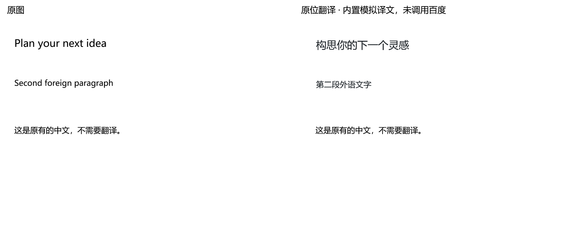

# QingSnap 贴图原位翻译试验报告

日期：2026-11-14。分支 `experiment/baidu-translation`，版本仍为 **v1.1.8**。本轮不更新正式版、不推送 GitHub。

> 本文记录初版中文覆盖实现。2026-11-16 已扩展为多语种与中英互译，当前行为和新增测试见 [多语种试验报告](PIN_MULTILINGUAL_TRANSLATION_TRIAL_REPORT.md)。

## 已实现的交互

1. 普通贴图/长图右键“翻译为中文”，中文在原图文字位置显示，不打开独立翻译窗口。
2. 贴图获得焦点后 **Ctrl+T** 发起原位翻译；之后切换原图/译图，复用当前贴图缓存、不重复请求。请求中 Ctrl+T 取消。
3. 在原图选中文字后右键“原位翻译所选文字”，只发送、覆盖所选区域。
4. 中文译图保留拖选复制能力，不需要再次对中文进行 OCR；右键可复制完整译文。
5. 增加“复制译图 / 保存译图”。原复制/保存行为不变，中文显示时明确标为“复制原图 / 保存原图”。历史文件不被覆盖。
6. 右键“翻译设置”主动配置账号。缺少配置或 OCR 时使用贴图内提示，不自动打开翻译窗口，不自动安装 OCR。
7. 独立文字对照窗口降为辅助入口；托盘先显示截图/贴图功能，试验启动器默认打开设置。

## 实现逻辑

### 原图和中文覆盖层

- `_image` 始终保持原始 BitmapSource，不把中文绘制回原图文件。
- 复用现有 OCR 文本坐标，坐标单位始终是原图像素，不采用屏幕坐标或 DIP 作为原文定位依据。
- 过滤已有中文、数字及网址等；按列、邻接距离和行高合并相邻外语行，标题和其他列尽量分开。
- 译文在对应区域自动换行和缩小字号。超出可容纳范围则省略显示并提示，可复制完整译文，不盖住相邻区域。
- 从文字区域附近采样底色，以近似底色遮盖原字并绘制中文。浅底深字、深底浅字自动选择；复杂纹理只近似覆盖，不使用重型图像修复。
- 使用冻结的 **DrawingImage 矢量覆盖层**，日常显示不生成第二张完整长图。普通、固定阅读窗和长图共享同一覆盖数据。
- 覆盖层置于原图之上、选字/二维码/标注之下，不拦截鼠标事件；缩放预览直接复用现有内容 VisualBrush，因此包含中文层。
- 字体排版和背景采样在后台准备。仅完成的冻结图层在 UI 线程挂载，不做逐帧文字重排。

### 文字和译文区域对应

`BaiduTranslationService.Segments` 扩展原客户端，继续复用加密账号、限流、HTTPS 和取消机制。相邻段落用真实换行分隔，合并成约 1,000 Unicode 码点一批，目标固定中文；本机区域 ID 不发送。

每段返回必须通过 `trans_result.src` 核对原文，再回填该段 ID。可处理响应顺序变化、重复原文；缺失、多余或不匹配的响应不会盲目覆盖，也不自动重试，以免错位及重复计费。

已通过 agent-reach 读取[百度官方接入文档](https://fanyi-api.baidu.com/product/113)核对：常见问题第 1 项明确支持用换行分隔多段文本，返回格式包含 `src` 和 `dst`。这不是实际账号请求验证。

### 选字与导出

- 根据中文排版的字符高亮几何生成轻量选字坐标，按实际换行分组，不展示 OCR 分词框；未覆盖的原文坐标继续保留。
- 原文 OCR 与中文选字结果分别保留，切换视图时恢复对应结果、清除旧选择。
- 完整译文单独保留，即便图中空间不足省略显示，也可完整复制。
- 译图导出按原图像素尺寸合成，仅在用户主动复制/保存时生成 Bitmap。大于 256MB 的完整合成会拒绝并提示，仍可查看矢量译图和复制文字。
- 缩略图只生成现有约 180×130 范围的小图，收纳恢复不重新请求译文。

### 生命周期与异常

- 请求取消与版本校验阻止关闭、进入编辑、变更设置后的迟到结果回填。
- 进入标注/图像修改会失效译图与旧坐标缓存，不让旧文字覆盖新内容；现有标注仍在上层。
- 取消/失效会停止对应进度提示；关闭时取消网络和排版、解除 SettingsChanged 订阅、清除覆盖引用。
- 正文、密钥、签名、原始响应不写日志；失败记录类型/受控错误，原图和已有结果保留。仅用户主动点击才发送。
- 采用现有深浅主题菜单与贴图内提示，未增加常驻面板、动画框架、全局快捷键或云端图片上传。

## 修改文件

新增：

- `src/QingSnap.App/Services/BaiduTranslationService.Segments.cs`
- `src/QingSnap.App/Services/PinTranslationLayout.cs`
- `src/QingSnap.App/Views/StickyImageWindow.Translation.cs`
- `tests/QingSnap.Tests/BaiduTranslationSegmentTests.cs`
- `tests/QingSnap.Tests/PinTranslationLayoutTests.cs`
- `tests/QingSnap.Tests/PinTranslationWindowTests.cs`
- `docs/images/translation-trial/pin-inline-translation-demo.png`（合成演示，非用户截图）

扩展现有文件：

- `Models/TranslationModels.cs`：区域 ID 与译文结果。
- `Services/BaiduTranslationService.cs`：复用请求解析与限流，保留原文字对照 API。
- `Services/TrayIconService.cs`：将独立对照入口降为辅助。
- `Views/StickyImageWindow.xaml` / `.xaml.cs`：菜单、覆盖层、快捷键和选字接入。
- `Views/StickyImageWindow.Annotations.cs`：编辑时失效缓存、显式译图导出。
- `Views/SettingsWindow.xaml`、`Views/TranslationSettingsWindow.xaml`：说明原位操作。
- `QingSnap.App.csproj`：打包试用说明和本报告，不修改版本字段。
- `tools/Start-TranslationTrial.ps1`：默认设置入口，检测旧试验版，绝不结束正式版。
- `docs/BAIDU_TRANSLATION_TRIAL.md`：更新试用方式和效果边界。

产品版本、历史数据库、截图保存、F1/F2/F3、Shift+F1、Enter、Esc、Undo/Redo、已有剪贴板流程均未改动。

## 自动化验证

本轮新增 **40 项**：

- API 8 项：批量、乱序回填、错误响应保护、长文/emoji、重复原文、未启用/未同意/过量输入不发送。
- 排版 14 项：语言筛选、多列段落、局部选择、深浅背景、图片 DPI 标签、冻结图层、原图不变、完整文字保留和越界保护。
- 贴图集成 18 项：不弹翻译窗口、原图/译图切换无重复请求、只发送所选区域、中文选字、显式导出、Ctrl+T 不干扰既有键、取消与关闭、防迟到覆盖、编辑/设置变更、长图概览阅读、M 收纳恢复、预载结果、事件退订及合成预览。

首轮完整回归 561/561 通过；补充生命周期与收纳测试后 566/566 通过。最终交付校验见下方。

测试全部使用临时独立目录、合成图片、假账号和模拟 HTTP，未发送真实百度请求。没有读取用户截图或密钥。图片 DPI 标签和几何测试不等同于实际混合 DPI 显示器硬件测试。

## 已知边界与人工检查

这是横排文字的第一版原位覆盖；不承诺复杂照片底色无痕、原字体完全一致、竖排/旋转文字、所有表格单元格完美复刻。纯汉字日文可能被当作中文保留。大图需分段，超过约 20,000 字符或 500 文字区域时需先选部分翻译。

人工检查：

1. 保存并退出旧翻译试验版，启动新试验版，确认原账号/OCR 配置仍在，正式版继续运行。
2. 从试验版托盘贴一张英文图片，右键“翻译为中文”，确认中文原位显示、没有独立译文窗口。
3. Ctrl+T 来回切换，确认立刻恢复且无新请求；请求中 Ctrl+T 取消。
4. 原图只选一段翻译，检查未选区域不覆盖；在译图拖选中文并 Ctrl+C。
5. 分别复制原图、复制译图、保存译图，核对尺寸、文字、原历史文件不变。
6. 长图上下滚动、双击概览、固定阅读窗缩放、普通滚轮缩放、M 收纳恢复，检查覆盖位置与比例。
7. 在不同 DPI 和负坐标屏幕间移动，检查中文字仍跟随原图；文字编辑中的 Ctrl+T 不截获输入。
8. 网络错误、密钥错误、取消、关闭、进入标注后确认无迟到覆盖和卡住进度。
9. 白底、深底、渐变/照片分别对比，检查近似覆盖和过长文字提示是否可接受。
10. 真实账号服务开通、第三方密钥使用政策及费用仍由用户本机主动验证。百度第三方使用和同 IP 多 APPID 提醒继续保留。

## 最终交付校验

- 最终完整回归 **566/566 通过，0 失败、0 跳过、无排除项**；约 1 分 22 秒。预览生成单项另外通过。
- 整个解决方案 Release 编译 **0 Warning、0 Error**，win-x64 发布成功。
- 新程序：`C:\Users\20150523\AppData\Local\QingSnap\TranslationTrial\20261114-inline\QingSnap.exe`。
- 旧试验版保留在 `TranslationTrial\20261114`，正式版保留在 `LocalTrials\ssd-normal-20261106`，均未覆盖。
- 文件版本 `1.1.8.0`，产品版本 `v1.1.8`，版本号未改变。
- EXE SHA-256：`AAB3523E0A765828010BB4177201529A71B1E171C25EB90734971E3E7BD46583`。
- 自签名证书仍为 `76DE14BC6B4E262B3DB8A62E90320A30009F5834`。系统提示根证书不受信任，未修改信任根，不声称受 CA 信任。
- 试用包：`artifacts/translation-trial/QingSnap-InPlaceTranslation-Trial-win-x64.zip`；其校验值见同目录同名 `.zip.sha256` 文件。
- 打包时旧试验版仍在显示设置窗口，因此没有强制关闭或同时启动两个使用同一试验数据目录的进程。用户保存退出旧试验版后，使用独立启动器切换；该工具不会结束正式版。
- 正式版 settings.json 校验仍为 `260467DE76420F96506BE4342B96F989E390270D5ACAC3BB47A58214AA74845D`；开机启动文件仍为 `35425F91DF111A9052169168FB23FC038893E1FB57A67DEA5EA1BEA060B65294`。
- 没有读取/重写试验版密钥；既有试验 Data/OCR 配置继续使用。没有推送、发布或替换正式 Release。
- 真实百度账号联调和实际混合 DPI 硬件检查尚未完成，模拟测试不代表云端翻译质量或实际费用验证。
