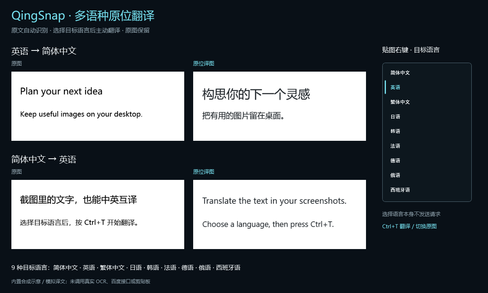

# QingSnap 多语种原位翻译试验报告

日期：2026-11-16。独立分支 `experiment/baidu-translation`，版本保持 **v1.1.8**；不覆盖正式版，不发布 GitHub，不迁移正式版设置/历史/OCR。

## 使用方式

贴图右键 → **目标语言** → 选择 → **翻译为… / Ctrl+T**。简体中文用于英译中，英语用于中译英；原文仍自动识别。

沿用原有九种语言目录：简体中文 `zh`、英语 `en`、繁体中文 `cht`、日语 `jp`、韩语 `kor`、法语 `fra`、德语 `de`、俄语 `ru`、西班牙语 `spa`。不新增依赖、翻译模型或全局快捷键。

## 核心实现

- 复用 `TranslationLanguages` 与 `AppSettings.TranslationTargetLanguage`。旧配置缺字段继续安全默认为简体中文，不新增平行设置模型。
- 设置中的默认语言适用于新贴图；现有贴图若未单独选择也跟随默认值，手动选择过的贴图保持自己的目标语言。单图选项只驻留本窗口，不改全局默认。
- `TranslateSegmentsAsync` 不再写死 `zh`，向现有百度请求传入目标；源语言维持 `auto`。请求前拒绝未知语言码，不产生无效请求。
- 简体中文整图翻译保留原有中文/数字/网址过滤。非中文目标和明确选中的文字可包含中文，真正支持中译英及简繁转换；网址与纯数字仍跳过。
- 同源同目标的响应若与原文字完全相同，不绘制遮罩，也不删掉原选字结果，避免把本来不需翻译的内容重新排版。
- 原文/目标文通过供应商回显 `src` 严格映射；原有串行限流、取消、不自动重试及受控日志规则不变。仅用户主动请求时发送文字，不上传图片。
- 目标语言对应字体回退和排版 Culture；生成与当前译文一致的选字坐标和 LanguageTag。按实际字符串跨度保留英文等译文的单词空格，避免逐字符拼接丢失空格。
- 继续使用冻结 DrawingImage 覆盖层、原图物理像素坐标。缩放、长图阅读、收纳、复制/保存原图和明确导出译图沿用现有管线。

## 菜单与生命周期

- 在现有 `PinMenuItem` 样式内增加轻量子菜单、箭头与选中高亮，复用深浅主题。没有独立主要翻译窗口或新常驻面板。主菜单高度有限且可滚动，避免更多入口挤出屏幕。
- 选择语言本身不联网；切换语言恢复原图并取消旧任务，版本检查阻止迟到结果回填。随后由用户按 Ctrl+T 或菜单开始。
- 每张贴图采用最多 **2 项** LRU：键为目标语言、范围及原 OCR 对象身份。只有完整成功结果进入缓存；命中提升最近使用次序。整图与选字不会混用；不同语言不会交叉显示。
- 缓存保存矢量覆盖和轻量文字坐标，不保存第二张完整位图、不跨窗口共享。编辑失效、关闭及解除事件订阅时清除引用。
- 原有 Ctrl+T 原图/译图切换、请求中取消、F2 标注、M 收纳、Esc 关闭、F1/F3/Shift+F1 模式均保留。

## 修改文件

应用：

- `src/QingSnap.App/Models/TranslationModels.cs`
- `src/QingSnap.App/Services/BaiduTranslationService.Segments.cs`
- `src/QingSnap.App/Services/PinTranslationLayout.cs`
- `src/QingSnap.App/Services/PinTranslationCache.cs`（新增）
- `src/QingSnap.App/Views/StickyImageWindow.Translation.cs`
- `src/QingSnap.App/Views/StickyImageWindow.xaml`
- `src/QingSnap.App/Views/TranslationSettingsWindow.xaml`
- `src/QingSnap.App/QingSnap.App.csproj`（仅新增报告打包）

测试与文档：

- `tests/QingSnap.Tests/BaiduTranslationSegmentTests.cs`
- `tests/QingSnap.Tests/PinTranslationLayoutTests.cs`
- `tests/QingSnap.Tests/PinTranslationCacheTests.cs`（新增）
- `tests/QingSnap.Tests/PinTranslationWindowTests.cs`
- `docs/BAIDU_TRANSLATION_TRIAL.md`
- `docs/PIN_INLINE_TRANSLATION_TRIAL_REPORT.md`（旧报告增加当前报告链接）
- 本报告及 `docs/images/translation-trial/pin-multilingual-translation-demo.png`（新增合成示意）

## 验证

- 完整 Release 测试 **603/603 通过，0 失败，0 跳过**（此前 574，新增 29）。
- 翻译相关定向回归 **80/80 通过**。
- 九种 API 目标参数及 `from=auto`、无效目标拒绝、中文规划、八种非默认语言排版及英文空格复制。
- 同文不覆盖像素、双语言缓存命中、范围/原 OCR 身份隔离、LRU 淘汰、关闭清除、请求中切语言取消、设置默认与单图选择隔离。
- 深/浅语言菜单模板、现有翻译设置最小尺寸/100–200% 渲染、普通与长图/不同 DPI、原图导出不变等原有测试继续通过。
- 所有 HTTP 为模拟，OCR 为合成坐标；没有读取真实账号、用户截图、剪贴板或调用百度。示意图使用实际覆盖排版与菜单模板，但译文为内置样例。

最终 Release 编译与本机切换结果见本报告末尾验证记录。

## 人工检查

1. 英文图选简体中文、中文图选英语，核对原位译文，Ctrl+T 切回原图。
2. 分别选择日/韩/法/德/俄/西班牙语、繁体中文，核对账号语言支持和输出字符。真实 OCR 是否识别这些原语言取决于当前 OCR 模型，本次未替换模型。
3. 只选择文字再翻译，核对不覆盖未选区域；复制英文译文，检查单词间空格。
4. 中文/英语来回切换并主动翻译，确认最近两份命中；切第三种目标后最旧结果可被淘汰，重新请求须由用户主动触发。
5. 请求中换语言、取消、关闭、进入标注，确认无迟到覆盖。多贴图分别选语言不互相影响。
6. 更改设置默认值、关闭重开试验版，检查默认语言保存，现有账号和 OCR/历史不变。
7. 深浅主题、150/200% DPI、不同显示器、长图滚动、缩放、M 收纳恢复，确认菜单完整、译文位置稳定。
8. F1/F3/Shift+F1、F2、Esc/Enter、Ctrl+Z/Y、Ctrl+C/V 及原图/译图导出，检查既有行为。

## 限制

仍为百度在线文本翻译，不是离线翻译。真实识别率、译文质量、账号语言授权、计费及网络耗时需用户主动试用验证；没有替用户发起真实付费请求。

默认译为简体中文时，纯汉字日文/繁体与简体难以只靠字符可靠区分，保留旧整图过滤；需要时可先选文字主动翻译。多语言混排可优先按所需段落选择。复杂底图仍为近似底色覆盖；目标文字变长时可能缩小或省略，完整文本可复制。

## 最终验证记录

- `dotnet build QingSnap.sln -c Release --no-restore`：整个解决方案 **0 Warning / 0 Error**。
- `dotnet test QingSnap.sln -c Release --no-restore`：**603/603** 通过，耗时约 1 分 17 秒；记录位于忽略目录 `artifacts/test-results/multilingual/multilingual-translation.trx`。
- `dotnet publish ... -c Release -r win-x64 --self-contained false` 成功；仍为 .NET 8 框架依赖包，文件版本 `1.1.8.0` / 产品版本 `v1.1.8`。
- 使用现有 QingSnap 自签名证书 `76DE14BC6B4E262B3DB8A62E90320A30009F5834` 对 EXE 做 SHA256 签名，未安装信任根。Windows 仍不视为受公开信任证书签名，不承诺消除 SmartScreen。
- 新 EXE SHA256：`E4088E2B79B348BE82F1EC7AA4B98B5A8E0388DE96640D42ADE9994B84AEB785`。
- 用户关闭贴图后，使用专用启动器正常退出旧试验版，启动 `%LocalAppData%\QingSnap\TranslationTrial\20261116-multilang\QingSnap.exe`；进程响应正常，Normal / BasePriority 8。
- 本次会话沿用用户批准的全局快捷键模式；日志确认注册 F1、Shift+F1、F3。默认试验版隔离策略未改变。
- 旧程序保留于 `TranslationTrial\20261116-hotkeys`；账号、OCR、历史仍使用既有 `TranslationTrial\Data`，未读取或重新写入真实密钥。
- 正式版主仓库 HEAD 仍为 `d10b60721590f2fc7856b8bd3f5ad92fd8c11dc0`；正式版 `settings.json` 及开机启动 `QingSnap.cmd` 的 SHA256 与操作前一致。
- 本地压缩包：`artifacts/translation-trial/QingSnap-TranslationTrial-multilang-20261116-win-x64.zip`，旁附 SHA256；不包含用户数据或密钥。不推送、不创建 GitHub Release。
