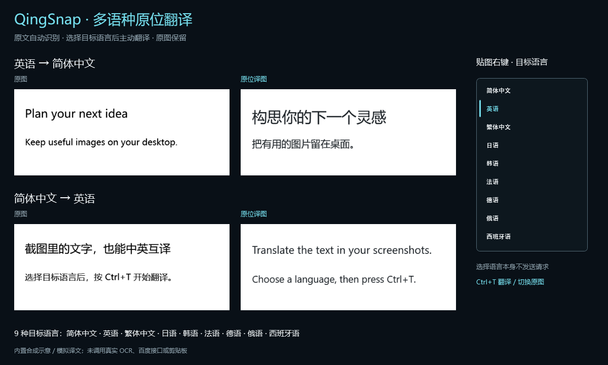

# 翻译实验版 / Translation Preview

**这是独立 Pre-release，不是正式版更新。程序版本仍为 v1.1.8，main 和正式版 Latest 不变。**

## 试用内容

- 贴图右键选择目标语言，点击翻译或按 Ctrl+T，译文直接覆盖原位置，不必打开独立对照窗口。
- 支持中英互译，以及繁体中文、日语、韩语、法语、德语、俄语和西班牙语目标。原文自动识别；实际原语识别能力取决于安装的 OCR。
- 支持只翻译所选文字、原图/译图切换、译文拖选复制、明确复制/保存译图。原截图和普通原图复制/保存不被改写。
- 每张贴图最多缓存两份近期语言/范围结果；切换语言本身不发送请求，缓存命中不重复请求。

## 下载与启动

1. 下载 `QingSnap-TranslationTrial-preview-20261116-win-x64.zip`，校验同名 `.sha256`，解压到**独立目录**。不要覆盖正式版。
2. Windows 10/11 x64，需已安装 .NET 8 Desktop Runtime。运行 `QingSnap.exe`，从标为“翻译试验版”的托盘操作截图、贴图和设置。
3. **默认不注册全局 F1/F3**，可与正式版并行。若要使用实验版 F1/F3，请先退出正式版，再通过快捷方式在程序路径后加 ` --enable-global-hotkeys` 启动；若实验版已经运行，也需先从其托盘退出再重启。返回正式版前先退出实验版。不要同时争用快捷键。
4. 在试验版设置中单独安装 OCR、配置自己的百度通用文本翻译 APPID/密钥并确认云端处理提示。缺少组件时不会自动下载或发翻译请求。
5. 贴图右键“目标语言”选择简体中文用于英译中，英语用于中译英，再按 Ctrl+T。再次按下可切换原图/译图；请求中可取消。

[完整试用说明](https://github.com/za5132-web/QingSnap/blob/translation-preview-20261116/docs/BAIDU_TRANSLATION_TRIAL.md) · [实现与测试报告](https://github.com/za5132-web/QingSnap/blob/translation-preview-20261116/docs/PIN_MULTILINGUAL_TRANSLATION_TRIAL_REPORT.md)

## 数据与安全边界

- 设置、历史、OCR 和凭据独立保存于 `%LocalAppData%\QingSnap\TranslationTrial\Data`；portable.flag 模式使用当前实验目录 Data。不会继承、修改正式版用户数据或开机启动，不执行正式版自动更新。
- **翻译不是离线功能。** 本地 OCR 后，仅用户主动翻译时向百度发送文字，不上传图片。需要自备账号，费用和使用规则以平台为准；测试连接也会消耗少量额度。
- 官方接入说明有第三方软件密钥使用和同 IP 多 APPID 限制提示，请先确认账号政策。密钥由 Windows 当前用户加密保存，不包含在 ZIP、普通设置或反馈日志中。换电脑/用户需重新填写。
- 包内不含 OCR 运行库/模型、用户账号、日志、历史或其他用户数据。没有真实账号或付费翻译请求验证；自动化使用模拟服务和合成图片。
- 使用项目原有自签名证书签名，并非公开受信任证书；Windows 可能仍显示安全警告。

## 已知限制与验证

纯色界面效果较好，复杂底图采用近似底色覆盖；长译文可能缩小或省略，可复制完整译文。默认整图译为中文时保留原有中文过滤，纯汉字日文等需要时可选字主动翻译。多语种 OCR 识别率与翻译质量请按实际内容试用。

完整解决方案 Release 编译 **0 Warning / 0 Error**；回归 **603/603** 通过。未进行真实百度计费、实际多语种 OCR 质量或多台实体显示器的全量人工测试。

问题反馈请注明“翻译实验版”和本标签 `translation-preview-20261116`，不要提交 APPID、密钥或敏感原文。

## English summary

This is an **opt-in translation preview**, not a stable update. Extract it separately; stable v1.1.8 remains Latest. Use the trial tray by default. Exit stable first if opting into F1/F3 via `--enable-global-hotkeys`.

Translation uses local OCR plus your own Baidu text-translation credentials. Only explicit requests send text to Baidu; images are not uploaded. Choose a target language in the pin context menu, then press Ctrl+T. Credentials, OCR and history are isolated. This self-signed, framework-dependent package requires .NET 8 Desktop Runtime. Real API billing and language quality require manual evaluation.
