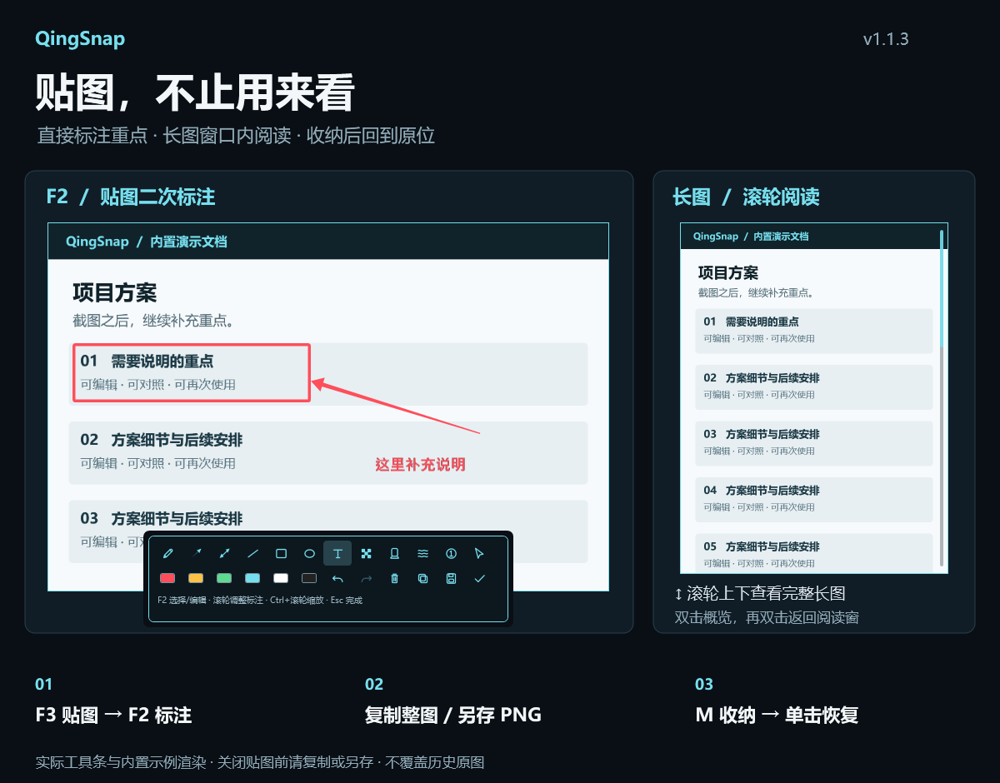

# QingSnap v1.1.3

贴图二次标注、长图阅读与边缘收纳恢复更新。

*使用内置示例内容和真实工具条渲染，无用户图片或剪贴板数据。*

## 贴图二次标注

- F3 贴图后，右键“标注图片”或按 F2，直接画箭头、矩形、文字、序号、马赛克等。
- 复用现有多选、移动、端点调整、文字/序号编辑、Ctrl+Z/Y 重做撤销、复制粘贴和图层操作。
- Esc 或对钩完成标注；编辑文字时 Enter 提交、Esc 取消文字编辑。完成后 Esc 恢复为关闭贴图。
- 工具条复制按钮输出完整合成图片；另存输出 PNG。长图导出包含当前阅读窗口之外的内容。
- 新增标注只保留在当前贴图窗口；关闭前请复制或另存。原历史文件不自动覆盖，原图已有的像素标注不能拆解为可编辑对象。
- 标注期间暂停选字，完成后按合成图片重新准备 OCR；旧识别结果和二维码热点不会在编辑后回流。

## 长图阅读与收纳

- 长图以原截图选区的位置和大小打开阅读窗，不再被旧的阅读窗尺寸限制强制缩放。
- 滚轮上下浏览；双击切换完整适屏概览，再双击返回原阅读窗及阅读位置。
- 不足旧长宽比阈值的宽长截图也能进入阅读器；普通图片的原有缩放保持不变。
- 修复边缘收纳恢复时滚动滑块最小高度计算异常导致恢复中断的问题，保留阅读进度。

## 验证与兼容

- 完整解决方案 Release 编译：0 Warning / 0 Error（关闭在线 NuGet 漏洞审计，不代表安全扫描）。
- 166 项自动化测试通过；未运行 1 项会操作真实 Windows 开机启动项的旧迁移测试。
- 新增覆盖普通/长图合成、可视范围外标注、撤销重做、视图切换、文字提交、OCR 失效、真实工具条渲染、DPI 坐标换算与收纳恢复的测试。
- 用户已确认本机试用后发布；不宣称完成所有真实多 DPI、多屏和第三方软件组合重测。
- 配置、历史图片/数据库及可选 OCR 模块沿用原位置。基础包仍需 .NET 8 桌面运行时，使用原自签名证书。

## 下载

下载 `QingSnap-v1.1.3.zip`，退出旧版后解压运行。覆盖升级时保留 `Data`、`portable.flag` 等用户数据。发布页附 ZIP 的 SHA-256 校验文件。

## English

In-place pin annotation (F2), original-region long-image reader with wheel scrolling and double-click overview/return, and a fix for interrupted edge-dock restoration. Copy or export the full annotated image before closing the pin; history originals remain unchanged. The illustration uses synthetic demo content and the actual toolbar. Existing settings, history data, and optional OCR modules remain compatible.
