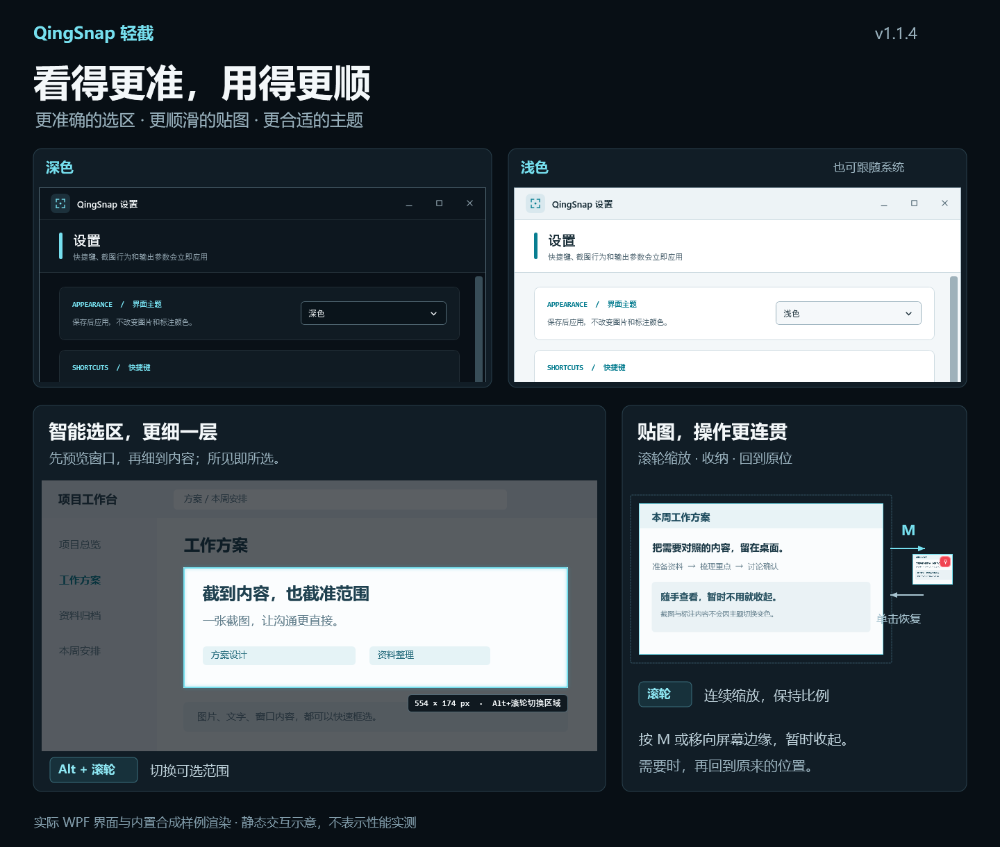

# QingSnap v1.1.4

智能选区、贴图运动与深浅主题更新。

*示意图使用内置演示 / 合成内容，不读取用户截图、剪贴板或历史记录。*

## 更自然的智能选区

- F1 后先使用 Win32 即时识别可见窗口和原生子窗口，鼠标停稳后在后台尝试 UI Automation 面板细化；无需在设置里切换识别模式。
- 预选阶段可用 `Alt+滚轮` 切换候选层级；单击采用当前看见的选框，不在点击时突然换成另一个目标。
- 过滤隐藏、完全透明和本进程窗口，使用可见边框；快速切换窗口后会丢弃旧请求结果。
- 后台只保留有限请求，不扫描整个桌面，不读取或记录控件文字；目标应用不提供结构、权限不足或查询异常时保留原生窗口识别。
- R / Shift+F1 历史范围、自由拖框及既有截图和标注快捷键保持原有工作流。

识别效果仍取决于目标程序的可访问性实现。UIA 调用不保证能被强制中断；慢或异常 Provider 会被隔离 / 降级，不保证每个第三方程序的每个面板都能识别。

## 贴图缩放与边缘收纳

- 滚轮缩放使用短时过渡，连续输入累计为新目标并从当前画面继续，不把每格滚轮排成一长串动画。
- 保留等比缩放、中心锚点和高精度位置；修正部分 DPI 环境下首次滚轮缩放突然跳大的倍率失配。
- M 收纳、边缘投放、点击恢复与侧边预览使用统一的短时运动入口；结束、取消或关闭后解除帧刷新订阅，不常驻空转。
- 系统关闭界面动画时直接进入最终状态；原有长图阅读、概览切换、阅读进度与贴图二次标注继续保留。

这些改动旨在改善手感，没有宣称在所有 GPU、显示缩放和刷新率下保证固定帧率或完全消除卡顿。

## 深色、浅色与跟随系统

- 在“设置 → 界面主题”中选择深色、浅色或跟随系统，点击保存后应用；旧配置默认深色。
- 设置、历史、标签、反馈、OCR / QR 结果、通知、长图控制、截图工具条、贴图菜单与教程外壳共用语义色刷。
- 独立统一托盘菜单、下拉弹窗、滚条、提示和临时标注工具条，避免切换后留下一块旧色控件。
- 跟随系统与高对比度采用事件驱动，不增加主题轮询；仅主题变化不重新注册全局快捷键或重启 OCR。
- 原图、外部剪贴板图片、用户标注颜色、二维码内容和最终导出像素不变；截图遮罩与红底白图钉保持功能性外观。

## 验证与已知边界

- 完整解决方案 Release 编译：**0 Warning / 0 Error**。
- 自动化回归：**235 / 235 通过**。另有 **1 项旧 `HistoryDirectoryMigrationTests` 未执行**，因为它会修改真实 Windows 开机启动项；该项不计作通过。
- 覆盖缩放数学、首格 DPI 校准、连续运动、收纳恢复、关闭清理、UIA 请求取消 / 过期 / 异常隔离，以及主题资源、实际窗口 / Popup / ToolTip 更新和原图不变。
- 使用合成内容完成深浅设置窗口与教程视觉检查；合成测试不等同于真实混合 DPI、多屏、不同 GPU 或 120 / 144Hz 帧率测量。
- 未完成 Chrome、Edge、Office、微信、CAD 等全部第三方应用组合的识别率和长时间操作实测。建议在自己的常用软件中验证面板选择、滚轮缩放和收纳恢复。
- 在线 NuGet 漏洞审计未作为本轮验收结论，不把编译通过等同于安全扫描通过。

## 升级与数据

- 下载 `QingSnap-v1.1.4.zip`，退出旧版后解压运行；基础包仍需要 **.NET 8 Desktop Runtime（x64）**。
- 配置、历史图片、数据库与可选 OCR 模块继续使用原位置；不修改历史数据库 Schema 或图片目录结构。便携模式覆盖升级时保留 `Data` 和 `portable.flag`。
- 旧版智能识别开关字段可被兼容读取并忽略，新的识别流程自动工作，不需要重建配置。
- 发布包沿用既有自签名证书。Windows 可能提示证书链不受信任；这不等同于受公开信任的发行者签名，也不要求安装根证书。
- 从本仓库 Release 页面下载，并核对附带的 `QingSnap-v1.1.4.zip.sha256`。发布页同时附本次功能示意图。

## English

This release adds automatic Win32 + background UI Automation selection, short retargetable pin zoom / edge-dock motion, initial DPI-scale correction, and Dark / Light / System themes. Use **Alt+wheel** during smart-selection preview to cycle candidate levels; no recognition-mode switch is required. Unsupported applications retain native window selection. Images, annotation colors, exports, history data, and optional OCR modules remain compatible.

Release build: **0 warnings / 0 errors**; **235 automated tests passed**. One legacy test that modifies real Windows Startup entries was excluded. Real mixed-DPI / high-refresh-rate hardware and the full range of third-party applications were not exhaustively tested. Recognition is provider-dependent, and no universal accuracy or frame-rate guarantee is claimed. The ZIP remains self-signed; verify its SHA-256 rather than installing a root certificate.
