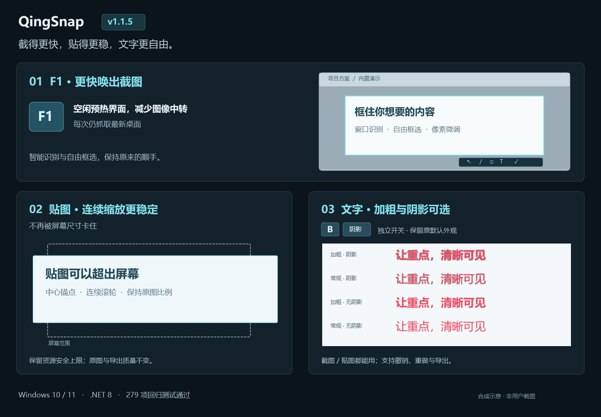

# QingSnap v1.1.5

截图更跟手，贴图缩放更稳定，文字样式更自由。

*本图为内置合成操作示意，不使用用户桌面、截图历史或剪贴板内容；不是动画帧率或性能保证。*

## F1 截图响应优化

- 软件空闲时用内置小图提前初始化截图界面，不显示蒙层，不启动 OCR，也不生成历史记录。
- 减少桌面图像的中间复制，将初始智能识别移出首帧关键路径，同时保留快速单击采用智能选区的行为。
- 每次 F1 仍抓取最新桌面，不使用缓存旧画面；用户主动设置的截图延时保持有效。
- 本机实际按键路径样本：程序内部首帧耗时首次约 **244ms**，随后约 **139～152ms**。不同硬件、桌面负载和显示器会有差异；此计时不包含操作系统投递热键前的排队时间，也不等同于光学显示延迟。

## 贴图缩放修复

- 修复连续滚轮缩放时的速度跳变、像素取整回摆，以及原生窗口尺寸变化造成的旧画面残留、短暂黑条和双边框。
- 缩放期间由临时固定画布呈现图片及交互层，最后交接回原贴图；结束、取消和关闭时释放画布、图像引用与回调，不常驻逐帧刷新。
- 普通贴图可以放大到屏幕范围之外；适应屏幕仍是主动查看方式，不再强制限制滚轮最大尺寸。仍保留既有最大 4 倍缩放及独立的硬件边长、像素面积安全预算，**不是无限放大**。
- 保留长图阅读、OCR 选字、二维码热点、二次标注，以及已稳定的 M 收纳、边缘投放和原位恢复。
- 原始图片、复制和导出分辨率不因显示预算改变。

## 文字标注样式

- 点击文字工具，在现有延伸面板中独立切换 **B（加粗）** 和 **阴影**；不额外增加常驻主工具栏按钮。
- 截图标注与贴图 F2 二次标注都可使用。可修改新文字、正在编辑的文字或选中的已有文字，多选时不改变非文字图形。
- 默认继续使用旧版半粗字重和阴影；可关闭加粗使用普通字重，阴影可单独关闭。
- 样式进入现有编辑事务和 Undo/Redo，复制粘贴与最终图片导出保留效果。

## 验证范围

- 完整解决方案 Release：**0 Warning / 0 Error**。
- 自动化回归：**279 项通过**。另有 **1 项既有 HistoryDirectoryMigrationTests 未执行**，因该测试会修改当前用户真实 Windows Startup 项；该项不计作通过。
- 新增覆盖：贴图资源预算、负坐标和 DPI 数学、原生超屏尺寸、呈现层关闭清理、连续滚轮、文字样式事务与导出、抓屏像素所有权及不透明 alpha。
- 使用合成内容做可见呈现检查；未将用户提交的私有 GIF 或其拆帧纳入仓库和发布附件。
- 不宣称在全部显卡、混合 DPI、多屏和高刷新率环境完全消除卡顿；仍建议在自己的常用环境中验证。未把短时资源采样解释为长期零泄漏证明。
- 本轮未把在线 NuGet 漏洞审计作为验收结论。

## 升级

- 下载 `QingSnap-v1.1.5.zip`，退出旧版后解压运行 `QingSnap.exe`。仍需要 **.NET 8 Desktop Runtime（x64）**。
- 配置、历史图片、数据库与可选 OCR 模块沿用原位置；没有新增配置或数据库 Schema。便携模式升级时保留 `Data` 和 `portable.flag`。
- 包含既有深浅主题、智能识别和全部 v1.1.4 功能，不需要重新安装 OCR。
- 沿用现有自签名证书；系统可能提示未知发布者或证书链不受信任。这不是公开受信任的商业签名，不要求安装根证书。
- 从本仓库 Release 下载，并核对附带的 `QingSnap-v1.1.5.zip.sha256`；发布页同时附功能示意图。

## English

This maintenance update improves F1 capture responsiveness with synthetic idle UI warmup and fewer image copies, fixes pin-wheel jitter/stale frames/black strips, allows safe zoom beyond screen bounds, and adds independent bold/shadow text annotation options in captures and pins. Every capture still uses fresh desktop pixels. Existing docking, long-image reading, OCR/QR, themes, shortcuts, settings, and history remain compatible.

Full Release build: **0 warnings / 0 errors**; **279 regression tests passed**. One legacy test that changes real Windows Startup entries was excluded. Local first-frame timing and synthetic visual tests are not universal hardware/refresh-rate guarantees. The package remains self-signed and requires .NET 8 Desktop Runtime x64. Keep `Data` and `portable.flag` when upgrading portable data, and verify the attached SHA-256.
