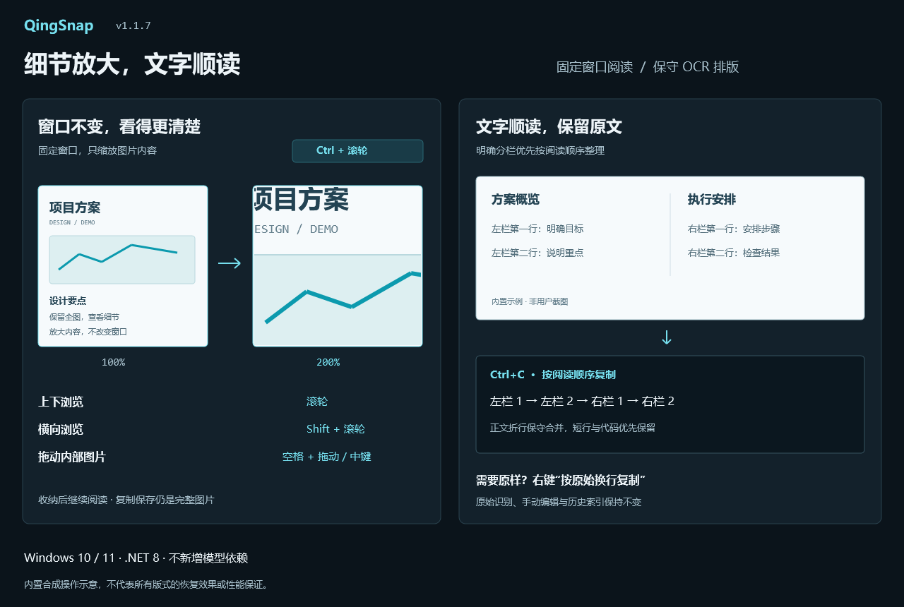

# QingSnap v1.1.7

窗口不变，细节放大；图片里的文字，复制得更顺。

*仅使用内置合成内容绘制，不含用户桌面、截图历史或剪贴板。图片是操作示意，不代表实际帧率、识别准确率或性能保证。*

## 贴图双层缩放

- 普通贴图滚轮仍缩放整个窗口；按 `Ctrl+滚轮` 可直接进入固定窗口阅读，只缩放内部图片。
- 阅读状态滚轮上下、`Shift+滚轮` 左右查看，`空格+左键拖动` 或中键拖动可平移内部内容；普通空白拖动仍移动窗口。
- 缩放同时保留横纵鼠标锚点，边界合理限位，小于窗口的图片居中显示，不独立拉伸宽高。
- 普通阅读窗双击切换完整图片与上次细节；长图仍双击切换阅读窗和完整概览。
- 右键增加固定窗口阅读、内容适应窗口、内容原始大小和恢复默认贴图；不新增常驻工具条。
- OCR 选字、二维码热点和标注共用原图坐标；收纳后恢复倍率和横纵阅读位置，复制/保存仍输出完整图片与标注。
- 内容动画只变换共享显示层，结束后提交布局；不逐帧调整窗口尺寸、不反复生成放大位图，空闲/关闭后停止刷新，遵循系统减少动画设置。
- **交互变化：阅读窗中的空格现在作为平移修饰键，不再单独翻页；请用 `PageUp` / `PageDown` 翻页。** 普通贴图双击、F3 图片循环、M 收纳和 Esc 关闭保留。

## 保守 OCR 排版

- 不更换 OCR 模型，在识别完成后后台生成派生阅读顺序和排版视图，并弱缓存复用；原始文字、行/字编号、坐标与历史索引不改写。
- 对有明确分隔的分栏，尽量先读完左栏再读右栏，保守处理跨栏标题与页脚；贴图跨行拖选不再简单按原始编号选取右栏内容。
- 只有完整选中的同区相邻正文行满足行高、对齐、间距等条件时才合并自然折行；不会补入未选中的行。
- 短诗、清单、明显代码、路径、网址、表格文本、缩进和句末标点优先保留换行；在有字框证据时修复部分异常中文/碎片英文空格，不改写数字、字词或专业术语。
- 贴图选字后 `Ctrl+C` 默认复制整理结果，右键“按原始换行复制”可保留原识别顺序和空格。
- OCR 结果窗默认显示整理结果，手动修改后复制仍取编辑区当前内容；右键“复制全文”按钮可复制原始识别全文。
- 全文及所选文字复制沿用现有剪贴板重试服务；失败保留内容并进入日志。

## 验证与边界

- 完整解决方案 Release：**0 Warning / 0 Error**。
- **423 项串行回归通过**；另排除 1 项会写入真实 Windows Startup 的既有 `HistoryDirectoryMigrationTests`，未计作通过。
- 新增覆盖窗口范围不变、双轴锚点、连续缩放、细节恢复、原图导出、标注 Undo/Redo、收纳位置、关闭释放、五档坐标比例、分栏、段落、保守空格、部分选择、取消和深浅主题原始复制入口。
- 10,000 行合成文字排版单次约 232ms，后续同一结果复用缓存；该数据**不包含模型推理**，不代表所有电脑或真实版式的速度。
- 复杂表格、竖排、旋转、图片穿插、缺失/错误坐标或已经混成一行的左右栏不保证恢复；困难版式请核对结果或使用原始复制。
- 真实混合 DPI、多屏、多显卡和所有第三方页面未穷尽验证，不作完全无抖动或通用识别率承诺。
- 未纳入本地未确认的冷启动/输入后端试验；未增加翻译、服务器、模型或第三方依赖。

## 升级

- 下载 `QingSnap-v1.1.7.zip`，退出旧版后解压运行 `QingSnap.exe`，需要 **.NET 8 Desktop Runtime x64**。
- 仍为不携带 OCR 运行库的基础包；现有 OCR 模块、设置和截图历史沿用原位置，无需重装模型。
- 无数据库 Schema 或配置字段变更。便携模式升级请保留 `Data` 与 `portable.flag`，不要覆盖或删除用户数据。
- 沿用原自签名证书；Windows 可能报告未知发布者/证书链不受信任，不要求安装根证书。请核对随 Release 提供的 SHA-256。
- 附件提供 ZIP、SHA-256 校验文件和本次合成示意图。[操作说明](https://github.com/za5132-web/QingSnap/blob/v1.1.7/docs/PIN_READING_AND_OCR_LAYOUT.md)。

## English

QingSnap v1.1.7 adds fixed-window content zoom with `Ctrl+wheel`, two-axis scrolling, Space/middle-drag panning, ordinary-pin detail restoration, and retained reading position after docking. Regular pin-wheel resizing and long-image overview switching remain available. Image, OCR selection, QR hotspots and annotations share coordinates, and copying/saving still exports the whole image. **Space is now a reading-pan modifier; use PageUp/PageDown for paging.**

Conservative, background-cached OCR layout improves clear columns, wrapped prose and spacing supported by character boxes without modifying raw OCR, history indexes or editor changes. Raw-copy fallbacks remain available; complex layouts are not guaranteed. No new model or translation dependency is introduced.

Release: **zero warnings/errors; 423 passing tests**, with one existing real-Startup-writing test excluded. The self-signed portable package requires .NET 8 Desktop Runtime x64. Preserve portable data, verify SHA-256 and review difficult OCR layouts. Local cold-start experiments are not included.
