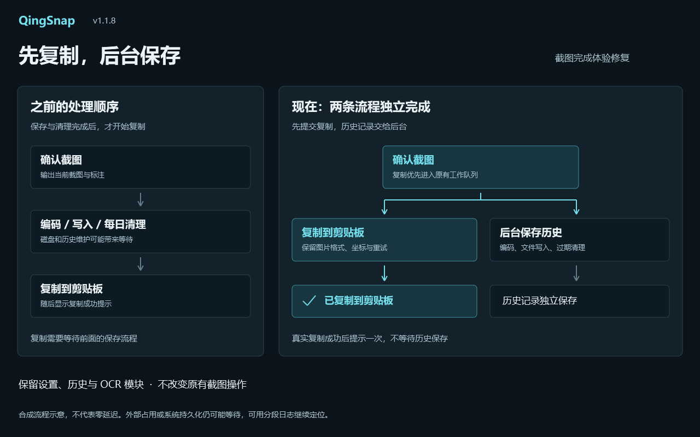

# QingSnap v1.1.8

截图先复制，历史后台保存。

*合成流程示意，不含用户桌面、截图历史或剪贴板；不代表零延迟或特定倍数提速。*

## 本次修复

- 移除“历史保存完成后才能开始复制”的阻塞：确认截图后优先向既有剪贴板工作队列提交图片，历史编码、文件写入和每日过期记录清理独立在后台执行。
- 每日首次保存可能需要扫描并回收过期历史；它不再是复制前置条件，历史查询与保存并发时也不会重复执行同一清理。
- 仅在实际复制成功后显示一次“已复制到剪贴板”，不等待历史文件保存，也不提前假报成功。保存和复制分别处理失败，一方失败不取消另一方的成功结果。
- 保留原有剪贴板图片格式、选区位置、Alpha 修复、互斥重试与持久化，兼容既有 F3 贴图流程。
- 后台文件保存按请求顺序执行；同毫秒小截图使用递增时间戳，保持原文件命名结构并避免覆盖。退出前等待已入队的文件保存。
- 补充剪贴板排队、准备、发布、持久化、历史保存和每日清理的分段耗时日志，不记录图片内容、剪贴板正文、OCR 正文或窗口标题。

## 验证与边界

- 完整解决方案 Release：**0 Warning / 0 Error**。
- **436 项回归通过**，包括新增 13 项：慢保存不阻挡复制、慢剪贴板不阻挡保存、失败组合、同步异常、关闭自动复制、通知异常隔离、连续保存、失败恢复与退出排空。
- 另排除 1 项会写入本机真实 Windows Startup 的旧 `HistoryDirectoryMigrationTests`，不计作通过。自动化不覆盖真实剪贴板、不调用 OCR 模型，不使用用户截图。
- 外部程序持续占用剪贴板、系统 OLE 持久化或资源压力仍可能导致等待，不承诺所有场景立即复制。隔夜首次截图仍需继续真实验收，分段日志可协助定位剩余延迟。
- 没有加入未确认的本地冷启动/输入后端试验，没有新增产品功能、模型、服务器、配置字段或数据库 Schema。

## 升级

- 下载 `QingSnap-v1.1.8.zip`，退出旧版后解压运行 `QingSnap.exe`，需要 **.NET 8 Desktop Runtime x64**。
- 保留既有设置、历史图片与 OCR 模块。便携模式升级请保留 `Data` 和 `portable.flag`，不要覆盖或删除用户数据。
- 沿用原自签名证书；Windows 可能提示未知发布者或不受信任的证书链，不要求安装根证书。下载后请核对 SHA-256。
- 附件包含 ZIP、SHA-256 文件及本次合成示意图。

## English

QingSnap v1.1.8 queues screenshot copying before saving history. Image encoding, disk writes and daily retention cleanup now run independently in the background. A single success toast follows a real successful copy without waiting for history. Save/copy failures remain independent, with existing clipboard formats, region data, retries, persistence and Alpha repair preserved.

Queued saves retain order, avoid same-millisecond filename collisions, and drain on exit. Phase timings help distinguish cleanup, queue, publication and persistence delays without recording image or text content. External clipboard contention and system persistence can still cause waiting; zero latency and overnight cold-state behavior are not guaranteed.

Release: **zero warnings/errors; 436 passing tests**, including 13 new cases. One existing test that writes real Windows Startup is excluded. No schema/config/model changes or unconfirmed cold-start experiments are included. The self-signed ZIP requires .NET 8 Desktop Runtime x64; preserve portable data and verify SHA-256.
