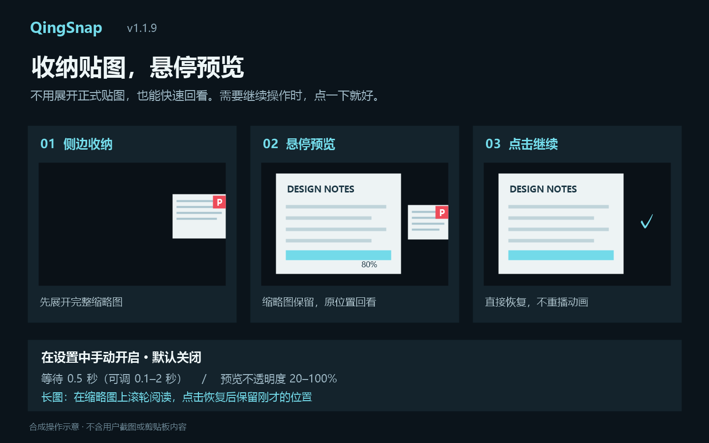

# QingSnap v1.1.9

收纳贴图，悬停预览。

*内置合成内容示意，不含用户桌面、截图历史或剪贴板。*

## 新增与修复

- 在「设置 → 贴图收纳」手动开启悬停预览，默认关闭，不改变原有使用习惯。
- 鼠标移到侧边标签：先展开完整缩略图，再在原贴图位置展示预览。默认等待 **0.5 秒**，滑块可调 **0.1～2 秒**；预览不透明度可调 **20～100%**。
- 预览时缩略图始终保留，作为稳定鼠标热区。移开后收回预览及缩略图；等待期间点击可立即恢复，预览已展开时点击直接转为正式贴图，不重播恢复动画。
- 长图阅读模式下，在缩略图上滚轮即可上下浏览预览，点击后仍停留在刚才的阅读位置。完整概览已经显示全部内容时无需滚动。
- 修复预览模式下缩略图停在边缘不收起，以及跳过完整缩略图阶段的问题。复用现有动画、图层和阅读位置逻辑，不在滚轮中反复生成位图。

## 升级与验证

- Windows 10/11 x64，需要 **.NET 8 Desktop Runtime x64**。退出旧版后解压运行，保留设置、历史和 OCR 模块；便携模式请保留 `Data` 与 `portable.flag`。
- 沿用原自签名证书；Windows 仍可能提示未知发布者或证书链不受信任，请核对附件 SHA-256。不要因此安装未知根证书。
- 本轮完整回归 **484/484 通过，0 失败、0 跳过**；全解决方案 Release **0 Warning / 0 Error**。一次既有历史保存测试临时文件占用曾在上一轮出现，未将其视为已修复。
- 已检查深浅主题及合成 100/150/200% 设置布局；真实混合 DPI、多屏负坐标、隔夜使用和高刷新率仍需实机验证。预览不提供选字、标注和二维码交互，单击恢复正式贴图后使用这些功能。
- 不合入翻译实验版或未确认的冷启动试验；不改变现有热键、历史图片和数据库结构。

## English

Optional dock hover preview is now available in Settings, off by default. Hover reveals the full thumbnail first, then previews the image at its saved desktop position after a configurable delay (0.5 s default, 0.1–2 s). Preview opacity is adjustable from 20 to 100%.

The thumbnail remains a stable input anchor. Leaving retracts the preview; clicking while waiting restores immediately, while clicking an expanded preview promotes it without replaying the restore animation. Scroll long-image reading previews over the thumbnail and keep that reading position when restoring.

Fixes edge-thumbnail retraction and reveal sequencing. Existing settings, history, OCR modules and portable data remain compatible. Translation experiments are not included. Full regression: **484/484 passed**, zero skipped; Release: zero warnings/errors. Real mixed-DPI/multi-monitor hardware testing remains necessary. Download the self-signed ZIP and verify its SHA-256.
